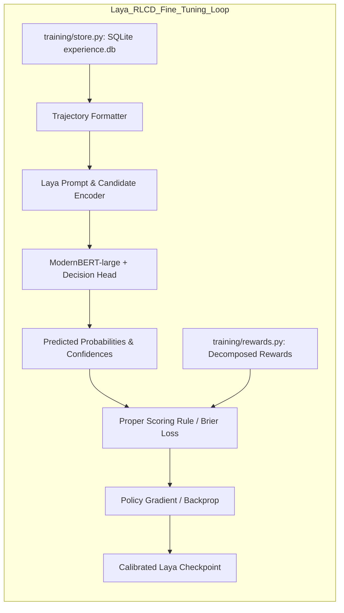
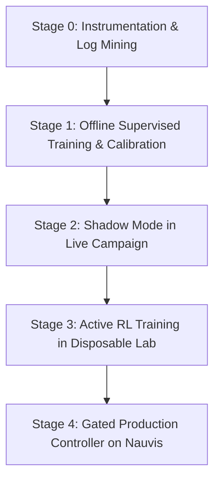

<!-- Path: docs/archive/rl/Laya_classifier_plan_antigravity.md | Purpose: Complete architectural blueprint and implementation plan for designing, fine-tuning, and integrating a Laya decision layer into the Factorio agent. -->

# Laya Classifier Plan: Fine-Tuned Decision Layer for Factorio Agent
**Document Label:** `Laya_classifier_plan_antigravity`  
**Target Model:** [convaiinnovations/laya](https://huggingface.co/convaiinnovations/laya) (ModernBERT-large 421M non-autoregressive decision engine)  
**Repository:** `Factorio_Cursor_RL_Agent`  
**System Charter:** [AGENTS.md](../../../AGENTS.md) & [docs/system_invariants.md](../../system_invariants.md)

---

## 1. Executive Summary & Laya Fit

The goal of this architectural blueprint is to design a high-performance, calibrated decision layer using **Laya** ([convaiinnovations/laya](https://huggingface.co/convaiinnovations/laya)) to take over macro-level decision-making in the Factorio Cursor RL Agent.

### Why Laya for Factorio Autonomous Control?
Traditional generative LLMs (e.g., 8B–70B autoregressive models) fail in real-time complex control loops:
- **High Latency**: 500ms to 3,000ms token streaming latency throttles the game loop.
- **Parsing Fragility**: Free-form text and markdown code blocks suffer from JSON syntax errors and hallucinated tokens.
- **Uncalibrated Confidence**: Generative LLM output probabilities reflect next-token likelihood, not mathematical truth or empirical reliability.

**Laya** is an open-weight, 421M-parameter non-autoregressive decision model:
- **Backbone**: Bidirectional **ModernBERT-large** (28 layers, hidden dimension 1024, 16 attention heads, GeGLU MLPs, 8192 RoPE context window). Full bidirectional attention enables state tokens and option tokens to attend to each other simultaneously.
- **Decision Head**: 2-layer TransformerEncoder head (`d=1024`, 16 heads, `FFN=4096`, Pre-LayerNorm, Dropout 0.1) augmented with learned question-type embeddings (`type_emb`: `choice=0`, `score=1`, `noul=2`).
- **Option Extraction Mechanism**: Options are rendered with `[MASK]` marker tokens. Hidden states at marker positions are extracted via `torch.gather` and projected by an Option Scorer MLP (`Linear(1024->1024) -> GELU -> Linear(1024->1)`) into scalar logits, yielding a temperature-scaled probability distribution $p = \text{softmax}(z / T)$.
- **Act vs. Escalate Head**: A specialized 2-layer MLP head takes the pooled `[CLS]` token (1024-dim) concatenated with 4 distribution statistics:
  1. Top probability: $\max(p)$
  2. Top-2 margin: $p_{\text{top1}} - p_{\text{top2}}$
  3. Normalized entropy: $H(p) / \log(K)$
  4. Option budget ratio: $K / 255$  
  It outputs calibrated $[P(\text{act}), P(\text{escalate})]$ probabilities to automatically gate autonomous execution versus deterministic fallback.
- **Latency**: **~33 ms to 38 ms** on GPU for a single forward pass, reaching **7.2 ms/question** when batched.
- **Decision Primitives**:
  - **`choice`**: Categorical selection over dynamically generated candidate criteria.
  - **`score`**: Placement on an ordinal rubric (e.g., scaling level 0..3).
  - **`noul`**: Calibrated boolean probability $P(\text{true}) \in [0.0, 1.0]$.
- **Calibration via RLCD**: Trained with Reinforcement Learning against Calibrated Decisions using strictly proper scoring rules (quadratic/Brier loss: $R = 2 p_y - \sum_k p_k^2$), guaranteeing mathematically grounded confidence scores.

---

## 2. How the Current System Actually Works

The repository currently separates real-base play from disposable training:

```mermaid
graph TD
    subgraph Deterministic_Runtime [Deterministic Runtime: Nauvis / Player]
        A[tools/autonomous_run.py] --> B[orchestrator/autonomous_builder.py: run]
        B --> C[orchestrator/live_base.py & extraction_state.py]
        B --> D[Cascading Heuristic Priority Ladder]
        D --> E[planners/ & stage_*.py]
        E --> F[orchestrator/game_bridge.py]
        F --> G[Factorio Server: factorio_mod/*.lua]
    end

    subgraph RL_Training_System [RL Training Environment: Disposable Surfaces]
        H[training/scheduler.py] --> I[training/episode.py]
        I --> J[training/candidates/mining_delivery.py]
        J --> K[training/policies.py: DiagonalLinUCB]
        K --> L[training/factorio_bridge.py]
        L --> M[Factorio Server: factorio_training_lab/*.lua]
        M --> N[training/rewards.py]
        N --> O[training/store.py: SQLite experience.db]
    end
```



### Complete End-to-End Control Trace

#### 1. Observation
- **Deterministic**: [orchestrator/live_base.py](../orchestrator/live_base.py) probes the game state via RCON and Lua exports:
  - Inventory: `available_items()`, `transferable_items()`, `chest_stored_items()`.
  - Power: `network_generation_kw()`, `network_firm_generation_kw()`, `network_accumulator_storage_mj()`.
  - Layout & Infrastructure: `find_line()`, `find_idle_machine_row()`, `occupied_tiles()`, `pending_ghost_count()`.
  - Resources: `nearest_resource()`, `drill_siting_conflicts()`.
- **RL Training**: [training/observation.py](../training/observation.py) compiles normalized numeric observations matching [schemas/training_transition.schema.json](../../../schemas/training_transition.schema.json).

#### 2. Decision Making
- In [orchestrator/autonomous_builder.py](../orchestrator/autonomous_builder.py), the control loop `run()` executes an unyielding, hardcoded cascading sequence of `if ... continue` checks every pass:
  1. `_top_up_solar_generation`: Brownout check.
  2. `_release_completed_construction_loans`: Reclaim borrowed assemblers.
  3. `_prep_intermediate`: Build standing mall assemblers.
  4. `_promote_mall_after_iron`: Promote mall after iron plates exist.
  5. `_prep_plate_foundation`: Build iron, copper, stone-brick starter direct stacks.
  6. `_prep_the_belt_cell`: Stand up transport belt assembly before extraction spends plates.
  7. `_prep_steel_district`: Build compact steel seed.
  8. `_prep_core_mall`: Manage assembler loans for 5 bootstrap entities.
  9. `_prep_plate_extraction`: Expand mining drills and smelter rows.
  10. `_serve_ready_pass`: Pop the highest-rated ready task from [orchestrator/priority_list.py](../orchestrator/priority_list.py).
- In [orchestrator/build_decisions.py](../orchestrator/build_decisions.py), decisions like `expansion_target()` and `_stage_inserter_type()` walk recipe trees deterministically.

#### 3. Geometric Planning
- Deterministic planners synthesize physical layouts:
  - [planners/belt_bridge.py](../planners/belt_bridge.py): A* orthogonal belt pathfinding.
  - [planners/local_layout_planner.py](../planners/local_layout_planner.py): Standard assembler rows.
  - [planners/quad_mall_layout.py](../planners/quad_mall_layout.py): 4-to-12 dense mall clusters.
  - [planners/smelter_block.py](../planners/smelter_block.py): 6/12/24 electric furnace blocks.
  - [planners/fluid_routing.py](../planners/fluid_routing.py): Collision-free, non-mixing pipe networks.

#### 4. Execution
- [orchestrator/game_bridge.py](../orchestrator/game_bridge.py) executes actions via Lua console commands on `factorio_mod`:
  - `/apply_ghost_plan` & `/execute_ghost_plan`: Ghost placement.
  - `/execute_construction`: Bot construction authorization.
  - `/build_layout_plan`: Entity placement, recipe configuration, direction, logistic sections/filters (`trash_not_requested=true`).
  - `/execute_upgrade_plan`: Native tier upgrades.
  - `/set_research`: Adds technology to queue.

#### 5. Verification & Supervision
- [tools/opencode_campaign_orchestrator.py](../../../tools/opencode_campaign_orchestrator.py) supervises the run. 4 aspect observers (timeline, supply, comparison, falsifier) track execution into `<state-root>/logs/campaign-loop/`.
- As recorded in [CURRENT_STATUS.md](../../../CURRENT_STATUS.md) (entries FIX-0001 through FIX-0013), this deterministic decision cascade frequently suffers from livelocks, premature assembler tier requests, power staging delays, and anchor loan starvations.

---

## 3. What Decisions Laya Takes Over vs. What Must Remain Deterministic

```
┌─────────────────────────────────────────────────────────────────────────────┐
│                       LAYA DECISION LAYER (Policy Brain)                    │
│  • Macro-action pass arbiter    • When to wait vs act    • How much to build│
│  • Task preemption/interrupt    • Site/zone selection    • Research picking │
│  • Loan & donor authorization   • Livelock diagnosis     • Strategy branch  │
└──────────────────────────────────────┬──────────────────────────────────────┘
                                       │ High-Level Choices & Scores (~33ms)
                                       ▼
┌─────────────────────────────────────────────────────────────────────────────┐
│                 DETERMINISTIC SAFETY SHIELD & VALIDATION                     │
│  • Factorio legality & collisions      • Runtime boundary isolation         │
│  • Material ledger & reservations      • Fluid purity (zero cross-mix)      │
│  • Emergency power failsafe            • Blueprint-only funding check       │
└──────────────────────────────────────┬──────────────────────────────────────┘
                                       │ Validated Action Directives
                                       ▼
┌─────────────────────────────────────────────────────────────────────────────┐
│                 DETERMINISTIC PLANNERS & GAME BRIDGE                        │
│  • A* belt & pipe pathfinding          • Machine layout geometry            │
│  • Ghost submission via GameBridge     • In-game RCON execution             │
└─────────────────────────────────────────────────────────────────────────────┘
```

### Hierarchical Laya Decision Space

| Decision Question | Primitive | Inputs / State | Dynamic Candidates / Rubric |
|---|---|---|---|
| **Macro Pass Arbiter**: "What primary action should the controller focus on this pass?" | `choice` | Bottlenecks, power reserves, ghost backlog, plate rates. | Generated dynamically: `[top_up_power, expand_iron, expand_copper, build_belt_cell, seed_steel, expand_mall_slot, serve_priority_task, wait_for_ghosts, recover_unpowered_mine]` |
| **Task Prioritization**: "Which item from the demand queue should receive construction resources now?" | `choice` | Stock vs target, consumer criticality, prerequisite chain. | Top-k ($k \le 8$) unscheduled candidates from `PriorityList.sync()` and mall targets. |
| **Task Preemption**: "Should the currently executing task be interrupted to address an emerging bottleneck?" | `noul` | Active task progress, severity of new deficit, bot backlog. | Boolean probability: `true` (interrupt and context-switch) vs `false` (run to completion). |
| **Expansion Sizing**: "How large should this production expansion be?" | `score` / `choice` | Measured consumption rate, resource patch richness, power headroom. | Ordinal scale: `[minimal_seed: 1-2, pod: 4-6, standard_row: 8-12, heavy_row: 24]`. |
| **Site Allocation**: "Which candidate site should be zoned for this layout?" | `choice` | Distance to inputs/outputs, land value, clutter density, obstacle count. | Clear zones returned by `live_base.find_clear_areas()` with distance & obstacle summaries. |
| **Assembler Loan Authorization**: "Can an existing assembler be borrowed for a temporary batch craft?" | `noul` | Active anchor machines, stock above floor, donor recipe demand. | Boolean probability: `true` (safe to borrow) vs `false` (would cause supply starvation). |
| **Technology Research**: "Which technology should be queued next?" | `choice` | Active science packs, prerequisite unlocks, goal requirements. | Bounded allowlist from `research_scheduler.py:eligible_technologies()`. |
| **Factory Health & Livelock Diagnosis**: "Is factory progress currently advancing or in a livelock?" | `noul` | Ghost completion rate, stock change deltas, pass unchanged count. | Calibrated probability: `P(healthy)`. If $<0.20$, triggers recovery protocol. |
| **Wait vs. Act**: "Should the controller hold this pass to allow bots and belts to catch up?" | `noul` | Number of live ghosts, bot flight times, ingredient transit. | Calibrated boolean probability $P(\text{wait})$. |

### Deterministic Hard Constraints (The Safety Shield)
1. **Collision & Placement Legality**: Bounding boxes, tile alignments, non-colliding entity placement ([planners/plan_validation.py](../planners/plan_validation.py), `live_base.occupied_tiles`).
2. **Fluid Purity**: Zero fluid mixing across pipe systems ([planners/fluid_routing.py](../planners/fluid_routing.py), [planners/fluid_layouts.py](../planners/fluid_layouts.py)).
3. **Power Grid Topology**: Copper wire connection rules, transformer/substation bounding, network generation ([planners/infrastructure.py](../planners/infrastructure.py), [orchestrator/stage_services.py](../orchestrator/stage_services.py)).
4. **Blueprint-Only Invariant**: All placements on `nauvis` must be blueprint ghosts funded by actual player inventory items and placed by bots ([factorio_mod/ghost_plans.lua](../../../factorio_mod/ghost_plans.lua), [factorio_mod/construction.lua](../../../factorio_mod/construction.lua)).
5. **Material Ledger & Reservations**: Material ledger locks guarantee no double-spending of inventory allocated to standing projects ([orchestrator/material_reservations.py](../orchestrator/material_reservations.py), [orchestrator/controller_budget.py](../orchestrator/controller_budget.py)).
6. **Geometric Pathfinding**: A* belt routing with preserved headings ([planners/belt_bridge.py](../planners/belt_bridge.py)).
7. **Emergency Safety Shield**: If power satisfaction $< 40\%$ or no progress occurs for $> 15$ passes, the safety shield intercepts and forces emergency stabilization.

---

## 4. Reusing RL Infrastructure for Laya Fine-Tuning



### 1. SQLite Transition Store as Dataset Source
In [training/store.py](../training/store.py), the `transitions` table persists exact state-action-reward tuples:
- `observation`: normalized numeric factory observations.
- `candidates`: complete list of candidate actions evaluated at that step, with their feature vectors.
- `chosen_action_id`: the action taken.
- `reward`: decomposed reward components.
- `result`: `{status: "completed"|"failed"|"timed_out", failure_kind: "none"|"safety"|"budget"|"strategy"}`.

### 2. Decomposed Rewards as Supervision Signals
In [training/rewards.py](../training/rewards.py), rewards are explicitly decomposed into `completion`, `throughput`, `elapsed_ticks`, `materials`, `poles`, `route_excess`, `land_usage`, `unproductive_drill_capacity`, `failed_placements`.
- Under Laya's **RLCD**, candidate options within an episode are ranked by their normalized advantage $A(s, a)$.
- Laya's Option Scorer is trained using **strictly proper scoring rules** (quadratic/Brier loss: $R = 2 p_y - \sum_k p_k^2$), aligning probability scores with empirical success rates.

### 3. Multi-Instance Parallel Simulation
- [training/scheduler.py](../training/scheduler.py) and [training/factorio_bridge.py](../training/factorio_bridge.py) spin up 20+ isolated Factorio headless server instances on ports `35000+i` (game) and `28000+i` (RCON).
- A new policy class `LayaPolicy` in [training/policies.py](../training/policies.py) evaluates candidate actions in ~33ms, allowing high-throughput RL training directly inside the Factorio simulation environment.

---

## 5. Transforming Historical Logs into Training Data

The repository contains extensive historical records:
- Deterministic campaign logs: `logs/autonomous-run.log`, `logs/deterministic-events.jsonl`, `logs/latest-context.md`, `logs/inventory-history.json`.
- Campaign supervisor history: `logs/campaign-loop/synthesis-*.md`, `logs/campaign-loop/git-*.md`.
- 35 training runs in [data/](../../../data) (`data/training/experience.db`, `data/training-linux-*/live/*.json`).

### Transformation Pipeline: From Unclassified Logs to Calibrated Tuples

```
Raw Run Logs + JSONL Events
         │
         ▼
┌─────────────────────────────────────────────────────────────┐
│ Pass Segmenter & State Reconstructor                        │
│ • Reconstruct (State_t, Candidate_Options_t, Action_t)      │
│ • Align inventory deltas, power readings, and ghost counts  │
└──────────────────────────────┬──────────────────────────────┘
                               │
                               ▼
┌─────────────────────────────────────────────────────────────┐
│ Outcome & Causal Attribution Engine                         │
│ • Forward lookahead window (Δt = +60s, +120s, +300s)        │
│ • Classify trajectory branch:                               │
│     - Progress (advancing stock, goal met)  ──> Label: POS  │
│     - Stagnation (passes without progress) ──> Label: NEUT │
│     - Fatal failure (livelock, starvation) ──> Label: NEG  │
│ • Cross-reference campaign supervisor FIX-0001..FIX-0013   │
└──────────────────────────────┬──────────────────────────────┘
                               │
                               ▼
┌─────────────────────────────────────────────────────────────┐
│ Laya Dataset Formatter (JSONL)                              │
│ • Compact JSON state (< 400 tokens)                         │
│ • Typed Question ('choice', 'score', 'noul')                │
│ • Option criteria dictionary (K ≤ 12)                       │
│ • Calibrated target probability distribution                │
└─────────────────────────────┘
```

#### Mining Specific Historical Failure Modes as Anti-Patterns
Using the exact root causes adjudicated in [CURRENT_STATUS.md](../../../CURRENT_STATUS.md):
1. **FIX-0010 (Assembler Tier Upgrades)**:
   - *State*: Base has 0 AM2 in stock; recipe catalog lists AM2 as standard.
   - *Historical Error*: Action `upgrade_to_am2` selected; resulted in stalled ghosts.
   - *Laya Example*: Target probability for `build_am1_cell` = 0.95; target probability for `upgrade_to_am2` = 0.05.
2. **FIX-0011 (Persistent Producer Starvation)**:
   - *State*: Starters retired, iron plates stocked, stock of iron gears and sticks decreasing to 0.
   - *Historical Error*: Controller deferred persistent producer, waiting for science pack demands.
   - *Laya Example*: Choice `schedule_persistent_gear_stick` target probability = 0.92.
3. **FIX-0005 & FIX-0006 (Power Staging & Chemical Wait)**:
   - *State*: Power infrastructure placed at (43, 35) but not generating; chemical ladder rungs waiting.
   - *Laya Example*: Question `should_park_and_retry`: `noul` target = 1.0 (prevent spinning on unpowered nodes).
4. **FIX-0072 (Anchor Cell Protection)**:
   - *State*: Only 1 permanent gear anchor exists; mall loan discovery requests borrowing it.
   - *Laya Example*: Question `can_borrow_cell`: `noul` target = 0.0 (protect sole anchor from loan starvation).

---

## 6. Laya Input/Output Schema & Context Representation

### The Token Budget
- ModernBERT-large context window: **512 tokens** (standard) or **1024 tokens** (`laya-typed-decisions`).
- Head length budget (`head_max_len`): **192–256 tokens** for instructions and option criteria.
- **Available budget for State**: **~300 to 700 tokens**.

### Structured State Document Format (~260 tokens)
```json
{
  "goal": "plastic-bar",
  "phase": "chemical_bootstrap",
  "elapsed_s": 1420,
  "metrics": {
    "power_satisfaction": 0.98,
    "firm_gen_kw": 4200,
    "bot_utilization": 0.35,
    "ghost_count": 8,
    "active_loans": 2
  },
  "stock_summary": {
    "iron-plate": 412,
    "copper-plate": 290,
    "transport-belt": 18,
    "inserter": 12,
    "pipe": 0,
    "electronic-circuit": 45
  },
  "rates_per_s": {
    "iron-plate": 15.2,
    "copper-plate": 12.0
  },
  "recent_history": [
    "-180s: built 6-smelter iron foundation -> plates flowing",
    "-90s: borrowed AM1 for inserter batch -> 24 crafted",
    "-30s: queued pipe batch -> waiting on iron loan"
  ],
  "active_alerts": [
    "pipe_stock_zero_limiting_chemical",
    "belt_reserve_low"
  ],
  "rules": "Establish metal foundation before steel. Do not borrow sole gear anchor. Keep choices within current inventory."
}
```

### Typed Decision Schema (Macro Pass Routing)

#### Input to Laya
```python
state = { ... }  # Dense structured JSON document above

questions = {
    "macro_pass_action": {
        "type": "choice",
        "instructions": "Which high-level action should the factory builder prioritize in this pass?",
        "criteria": {
            "remedy_pipe_shortage": "Queue pipe production in mall via available rotating loan cell",
            "build_belt_cell": "Construct dedicated transport belt assembler cell to replenish low reserve",
            "expand_iron_mining": "Add 6 electric mining drills to north iron patch",
            "seed_steel_district": "Place compact 6-furnace steel seed block",
            "wait_ghost_construction": "Hold actions to let construction bots finish the 8 active ghosts"
        }
    },
    "livelock_risk": {
        "type": "noul",
        "instructions": "Is the factory currently experiencing a circular resource deadlock?"
    },
    "expansion_urgency": {
        "type": "score",
        "instructions": "Rate the urgency of expanding raw iron ore extraction.",
        "criteria": ["unnecessary", "recommended soon", "critical bottleneck"]
    }
}
```

#### Output from Laya (Single Forward Pass, ~35 ms)
```json
{
  "answers": {
    "macro_pass_action": {
      "choice": "remedy_pipe_shortage",
      "confidence": 0.91,
      "probabilities": {
        "remedy_pipe_shortage": 0.912,
        "build_belt_cell": 0.054,
        "expand_iron_mining": 0.021,
        "seed_steel_district": 0.008,
        "wait_ghost_construction": 0.005
      }
    },
    "livelock_risk": {
      "noul": 0.042
    },
    "expansion_urgency": {
      "score": 0.82,
      "probabilities": [0.35, 0.48, 0.17],
      "confidence": 0.84
    }
  },
  "act_escalate": {
    "p_act": 0.94,
    "p_escalate": 0.06
  }
}
```

---

## 7. Dynamic Candidate Action Generation from Tooling

Laya does **not choose from a static global list**. Candidate actions are compiled dynamically by existing deterministic tools:

```python
# Path: orchestrator/laya_candidate_generator.py

def generate_macro_candidates(
    client: RconClient, surface: str, force: str, goal_item: str, stock: dict[str, int]
) -> dict[str, str]:
    """Generate legally valid candidate options for Laya's choice question."""
    candidates = {}
    
    # 1. Power Assessment
    power_kw = live_base.network_generation_kw(client, surface, (0, 0))
    if power_kw < 3000:
        candidates["top_up_power"] = f"Add solar/steam pod; generation is low ({power_kw:.0f} kW)"
        
    # 2. Ghost Backlog Check
    ghosts = live_base.pending_ghost_count(client, surface, force)
    if ghosts > 10:
        candidates["wait_ghost_construction"] = f"Wait for construction bots to complete {ghosts} ghosts"

    # 3. Supply Chain Bottlenecks
    shortage = build_decisions.expansion_target(goal_item, stock)
    if shortage:
        candidates[f"expand_{shortage}"] = f"Expand upstream extraction/smelting for starved {shortage}"
        
    # 4. Mall & Intermediate Batching
    if stock.get("pipe", 0) < 50 and not live_base.find_line(client, surface, force, "pipe", "assembling-machine-1"):
        candidates["batch_pipe"] = "Allocate rotating mall loan cell to produce 50 pipe"
        
    if stock.get("transport-belt", 0) < 100:
        candidates["produce_belts"] = "Prioritize transport belt cell production"

    # 5. Goal Production
    candidates[f"progress_goal_{goal_item}"] = f"Advance main assembly line for target {goal_item}"
    
    return candidates  # Bounded to <= 12 choices
```

---

## 8. Integration into the Repository Architecture

In [orchestrator/autonomous_builder.py](../orchestrator/autonomous_builder.py), `LayaDecisionLayer` integrates directly into `run()`, replacing lines 13048–13179:

```python
# In orchestrator/autonomous_builder.py: run()

# 1. Generate legal candidates from current live base
candidates = generate_macro_candidates(client, surface, force, goal_item, target_stock_now)

# 2. Build token-efficient structured state document
state_doc = build_compact_laya_state(client, surface, force, goal_item, budget, priorities)

# 3. Query Laya Decision Layer (~33 ms forward pass)
decision = laya_agent.predict(state_doc, build_pass_questions(candidates))
action = decision["answers"]["macro_pass_action"]["choice"]
confidence = decision["answers"]["macro_pass_action"]["confidence"]
p_act = decision["act_escalate"]["p_act"]

# 4. Safety Shield & Confidence Gating
if p_act >= 0.85 and confidence >= 0.80:
    emit(f"LAYA DECISION: {action} (conf: {confidence:.2f}, p_act: {p_act:.2f})")
    # Dispatch directly to existing reliable deterministic builder
    _dispatch_deterministic_action(action, client, bridge, surface, force, reference_point, emit)
else:
    emit(f"LAYA ESCALATE (conf: {confidence:.2f}): falling back to deterministic baseline")
    # Fallback to current deterministic cascade
    _fallback_deterministic_pass(...)
```

---

## 9. Additional Logging & Telemetry to Collect Before Training

To train Laya without ambiguity, we must record machine-readable logs at every decision point in **`decision-telemetry.jsonl`**:

### Schema for `decision-telemetry.jsonl`:
```json
{
  "version": "1.0.0",
  "decision_id": "dec-a8f3b201-9482",
  "timestamp_utc": "2026-09-19T16:20:00Z",
  "game_tick": 142800,
  "episode_id": "episode-plastic-bar-04",
  "state_vector": { ... },
  "candidate_options": {
    "top_up_power": "Add solar/steam pod; generation is low (2400 kW)",
    "batch_pipe": "Allocate rotating mall loan cell to produce 50 pipe",
    "expand_iron": "Expand iron mining drills"
  },
  "selected_action": "batch_pipe",
  "selection_source": "heuristic_baseline",
  "forward_lookahead": {
    "delta_ticks_1800": { "stock_delta": { "pipe": +50 }, "progress_credited": true },
    "delta_ticks_7200": { "goal_advanced": true, "stall_occurred": false }
  },
  "terminal_outcome": {
    "status": "completed",
    "failure_kind": "none",
    "total_reward": 184.2
  }
}
```

---

## 10. Staged Rollout Path: From Heuristic to Laya-Driven Controller



### Stage 0: Telemetry & Log Transformation
- Deploy `decision-telemetry.jsonl` logger in [orchestrator/autonomous_builder.py](../orchestrator/autonomous_builder.py) and [tools/autonomous_run.py](../../../tools/autonomous_run.py).
- Run log conversion pipeline across historical runs and 35 training sets, generating `factorio-laya-v1.jsonl` (~40,000 question-decision training pairs).

### Stage 1: Offline Fine-Tuning & Proper Calibration
- Fine-tune ModernBERT-large + decision head on `factorio-laya-v1.jsonl` using RLCD with proper scoring loss.
- Perform post-hoc temperature fitting per question type and candidate count to minimize ECE ($ECE < 0.08$).
- Verify validation accuracy $> 0.75$ on held-out split.

### Stage 2: Shadow Mode in Deterministic Campaign
- Run Laya in **read-only shadow mode** inside [tools/opencode_campaign_orchestrator.py](../../../tools/opencode_campaign_orchestrator.py).
- At each pass, Laya evaluates state in parallel with heuristics.
- Log agreement rate, latency, and measure whether Laya avoids historical stall points (e.g., FIX-0001..0013). Zero mutation to live base.

### Stage 3: Active RL Fine-Tuning in Disposable Training Lab
- Deploy Laya as `LayaPolicy` in [training/policies.py](../training/policies.py) across the multi-instance loopback testbed ([training/scheduler.py](../training/scheduler.py)).
- Train against Curriculum stages 1–5 (mining delivery, solid smelting, fluid handling, scaling).
- Optimize placement density, route efficiency, and throughput speed with reward signals from [training/rewards.py](../training/rewards.py).

### Stage 4: Gated Production Deployment on Nauvis
- Enable Laya execution on real Nauvis base behind the strict **Safety Shield**:
  - Gated by $P(\text{act}) \ge 0.85$ and confidence $\ge 0.80$.
  - Low confidence or unclassified situations cleanly escalate to deterministic baseline.
  - Automatic rollback on invariant tripwire.

---

## 11. Complete Citation Index

### Core Charter & Boundaries
- [AGENTS.md](../../../AGENTS.md): Charter, 3 boundaries, evidence levels, working loops.
- [docs/system_invariants.md](../../system_invariants.md): Runtime isolation, blueprint-only constraints, evidence truth.
- [docs/architecture.md](../../architecture.md): Shared contracts between RL and deterministic runtimes.
- [CURRENT_STATUS.md](../../../CURRENT_STATUS.md): Current status, campaign supervisor fixes FIX-0001 through FIX-0013.

### Deterministic Subsystems & Planners
- [tools/autonomous_run.py](../../../tools/autonomous_run.py): Real-base runner, telemetry logger, event classification.
- [orchestrator/autonomous_builder.py](../orchestrator/autonomous_builder.py): Main control loop `run()`, cascading heuristic priority ladder.
- [orchestrator/build_decisions.py](../orchestrator/build_decisions.py): Bottleneck traversal `expansion_target()`, replenishment diagnosis, inserter tier selection.
- [orchestrator/live_base.py](../orchestrator/live_base.py): Live Factorio state inspection via RCON/Lua.
- [orchestrator/priority_list.py](../orchestrator/priority_list.py): Persistent queue ranking construction tasks.
- [orchestrator/material_reservations.py](../orchestrator/material_reservations.py): Ledger preventing double-spending of inventory.
- [orchestrator/research_scheduler.py](../orchestrator/research_scheduler.py): Pure allowlist-bounded technology ranking.
- [planners/belt_bridge.py](../planners/belt_bridge.py): A* belt routing with preserved headings.
- [planners/plan_validation.py](../planners/plan_validation.py): Factorio legality and collision checking.
- [planners/quad_mall_layout.py](../planners/quad_mall_layout.py): Dense 4-to-12 mall clusters.
- [planners/smelter_block.py](../planners/smelter_block.py): Electric furnace array generation.

### RL Training Subsystems
- [training/store.py](../training/store.py): SQLite `experience.db` persistence for scenarios, policies, transitions, evaluations.
- [training/contracts.py](../training/contracts.py): Validation of scenarios and transitions at package boundaries.
- [training/rewards.py](../training/rewards.py): Multi-component decomposed reward formulation.
- [training/policies.py](../training/policies.py): Candidate selection policies (`DeterministicBaseline`, `DiagonalLinUCB`).
- [training/candidates/mining_delivery.py](../training/candidates/mining_delivery.py): Geometric candidate layout compiler.
- [training/factorio_bridge.py](../training/factorio_bridge.py): Loopback RCON bridge to `factorio_training_lab`.
- [schemas/training_transition.schema.json](../../../schemas/training_transition.schema.json): Authoritative transition schema.

### Campaign Supervision & Operations
- [tools/opencode_campaign_orchestrator.py](../../../tools/opencode_campaign_orchestrator.py): 12-hour campaign supervisor loop.
- [tools/campaign_loop_log.py](../../../tools/campaign_loop_log.py): Append-only history of syntheses, fixes, and hypotheses.
- [docs/deterministic/run_context.md](../../deterministic/run_context.md): Bounded 12k evidence packet standard.
- [docs/factorio_operations.md](../../factorio_operations.md): Ports, deployments, and lifecycle procedures.
