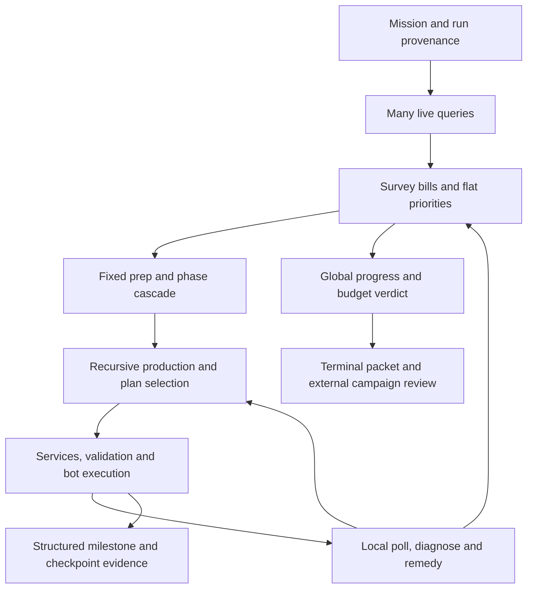

<!-- Path: docs/deterministic/Deterministic_Workflow_Audit_2026-10-08.md | Purpose: Audit the deterministic runner end to end and propose reusable diagnostics and regression controls without changing runtime policy. -->

# Deterministic workflow audit — October 8, 2026

Yes: the runner can become substantially easier to troubleshoot and more robust.
The highest-value change is to make its existing work, dependencies and evidence
explicit, then make scheduling and recovery act on that shared state. Extracting
13,212 lines into more files alone would preserve the present coupling.

This audit recommends a gradual migration, not a rewrite or another catalog of
recipe-specific exceptions. It leaves the maintained deterministic incumbent
usable and produces mechanics/observations that Laya can reuse. No implementation,
service, save, installed mod, deployment or production authority changed.
The other agent's Laya work is outside this audit's edit scope.

## Scope and evidence limits

Reviewed the complete top-level workflow: lifecycle/provenance, produce/research
entry points, observation, scheduling, bootstrap/mall, extraction/conversion,
transport/power/coverage, validation/execution, recovery, progress/termination,
mission evidence, helper/campaign review, and checkpoint regression machinery.
Inspected representative mechanisms at each boundary and their focused tests.
This is an end-to-end architectural and behavioral audit, not line-by-line
certification of every planner or Lua branch, nor a new multi-map evaluation.

Source identities were captured at 01:11 IST in
`/tmp/deterministic-audit-source-identity.json`; checked core files did not drift
during the audit. HEAD moved as the other agent worked, so the source hashes,
not the eventual branch HEAD alone, identify the inspected implementation.
The checkout includes unrelated dirty work, including shared Lua and planners.

The central builder contains **218 top-level functions, 72 module assignments,
917 if-nodes and 226 exception handlers**, including 138 broad `Exception`
handlers. Its twelve largest functions span 171–512 lines. There are 202
`live_base` call sites in the builder; this is static coupling, not an RPC count
or measured latency. Complexity counts alone do not prove any guard unnecessary.

Read the existing bounded packet first. It referred to a partial **September 18**
run although the raw log and mission ledger contained a completed **October 6**
run. Regenerated a packet at `/tmp/deterministic-audit-latest-context.md` without
changing the original. The newer run was externally terminated by SIGTERM after
1,478 seconds; it is not evidence that a stagnation detector found a deadlock.
Its inventory history could not be paired unambiguously, so rates remain unknown.

The shared ledger contains 455 deterministic records; 453 are outside obvious
pytest/test log paths: 315 stuck, 115 error, 16 unfinished, seven completed.
Common recorded codes include `no_progress` (110), `unhandled_exception` (82),
`untyped_stuck` (42) and `controller_iteration_limit` (21). These are historical
ledger rows across changing code, goals and conditions, with incomplete/unknown
revision identities and possible aliases. They are **not a matched success rate**,
and `completed` can mean research queued rather than technology researched.

Verification: five selected existing suites yielded **177 passed, one failed**.
The failing pole-batch fixture also failed in isolation; details below. Offline
probes reproduced retry wakeup, stale report ticks, recipe-catalog drift, incomplete
progress signatures, renewable budgets, strict geometry recovery and invalid
checkpoint classification. No fresh Factorio episode or live mutation was run.

## Current workflow

| Boundary | What currently happens | Why a later change can affect an earlier stage |
| --- | --- | --- |
| Lifecycle | Managers restore an isolated source, deploy/check mods, write a manifest and launch the runner. | HEAD/save/mod checks do not fully identify dirty Python bytes; direct runs can omit a manifest. |
| Mission | `tools/autonomous_run.py` dispatches produce or builds each sorted science pack, then queues research. | Each pack reopens controller state; successful queueing is marked complete before research completion. |
| Observation | Many `live_base` RCON queries read stock, lines, ghosts, services and resource patches. | Reads span different ticks and use several stock/producer meanings. |
| Scheduling | `_survey_pass` reconciles bills, promotes shortages, retires satisfied demands and selects `PriorityList.next`. | Critical bills, background reserves, pass-local prep and fixed phase gates compete through different rules. |
| Bootstrap | Prep, foundation reconciliation, belt/steel, core mall, promotions and extraction execute in a fixed cascade. | An earlier handler returning “spent pass” prevents later ready work from being considered. |
| Planning | `ensure_produced` recursively establishes prerequisites, selects capacity/site/tier and chooses mall versus line. | A broad request can build or borrow a different producer, changing unrelated feasibility. |
| Execution | `_submit` prepares/clears, preflights materials, stages services, authorizes and submits ghosts/configuration. | Service work and partial construction can occur before the requested production transaction completes. |
| Recovery | `bring_stage_up` polls, diagnoses one issue and applies a remedy; several remedies recursively request production. | Local recovery can consume scarce stock/capacity or wait inside the scheduler's call stack. |
| Termination | Pass signatures, stock sums, ghost counts and progress revisions renew budgets or trigger stops. | Incidental progress can hide a blocked goal; valid slow work can look unchanged. |
| Diagnosis/fixing | Helpers observe; campaign agents synthesize, patch, run a small gate and retry a fresh episode. | Evidence can be stale/synthetic; offline unit coverage does not prove earlier live transitions survive. |
| Regression | Checkpoint fleet supports immutable segment inputs plus fresh C0 evidence. | The inspected local registry has a C0 generation but no C1–C6 defaults/generations, so later segment protection is not populated there. |

The helper/campaign is an external observation-and-code-fix loop. It is not a
complete root-cause/recovery mechanism inside the factory controller.

## Findings

### 1. There is no complete runtime dependency explanation

The runner has valuable recipe graphs and `BootstrapWorkLedger`, but the latter
is used at one `depend()` call site in `_serve_mall_task`. It records a narrow
replenishment relation. It does not generally connect production to construction
materials, reservations, borrowed machine capacity, power, coverage, route
admission and phase gates. Recipe-only cycle detection cannot see those cycles.

Consequently the terminal selected item is often a symptom. Historical drill
stalls involved transferable inputs not reaching the loan's network; a later
coal failure stopped an automation-science controller. Local rules were added
at individual handoff seams instead of exposing one blocked dependency chain.

Project one read-only wait graph from the existing ledgers and observations.
Include `needs_item`, `supplied_by`, `reserved_by`, `borrows_capacity_from`,
`needs_service`, `needs_route` and `gated_by` edges, with episode/tick and evidence
references. Recipes have AND requirements and may have alternative suppliers;
not every cycle is a deadlock when a funded seed or finite buffer breaks it.
A graph-capacity limit is not a physical dependency cycle. The current work
ledger even labels a repeated existing edge at its capacity limit as
`dependency_graph_limit`; an offline probe reproduced that loss of idempotence.

Sources: `orchestrator/bootstrap_work.py:95`; `autonomous_builder.py:10272`,
`_reconcile_bootstrap_work`; `core/science_recipe_graph.py`.

### 2. Re-promoting the same demand defeats retry deferral

`_survey_pass` and `_promote_material_bill_prerequisites` promote binding items
on every survey. `PriorityList.promote()` sets ready status and `retry_tick=tick`
even if the demand and blocking facts are unchanged. A probe deferred a belt
request until tick 3,600; identical promotion at tick one immediately made it
selectable. Deferral and priority therefore have competing semantics.

Priority should select among eligible work. Changed demand, changed input facts,
a completed dependency or a real deadline can wake work; unchanged priority
inheritance should not cancel its wait. Inherit importance along dependency
edges instead of promoting every missing material to the same rating 100.
Persist a retry's relevant fact fingerprint and wake condition. Keep the
incumbent's heuristic ordering in one scheduler, not in each tool callback.

Sources: `autonomous_builder.py:12209`, `:12362`;
`orchestrator/priority_list.py:120`.

### 3. Progress and budgets do not measure objective progress reliably

`_controller_ground_progressed` accepts falling total ghost count, growth in a
sum of relevant stock, loan-craft revision or coverage revision. Stock for
background reserves is included. `_pass_signature` records mall item names but
not their target quantities: targets of one and 10,000 produced identical
signatures in a probe. Changing work identity can also reset stagnation without
producing useful service.

Progress refunds a pass and its plans, and expands plan/remedy/wait/diagnosis
caps. A probe executed 100 credited passes with a one-pass initial budget,
ending at zero consumed passes/plans and an 808-plan cap. This behavior is
intentional patience, but it cannot be an absolute runtime bound and its
soundness depends on the progress detector. External wall limits remain separate.

Track progress per obligation: remaining owned ghost bill, verified delivery,
remaining useful batch output, restored service and sustainable goal throughput.
Maintain both a **hard total resource/time cap** and a renewable work lease.
A working batch earns an ETA-based lease; unrelated stock growth does not erase
another transaction's stall. Use game ticks for production and monotonic wall
time for transport/host deadlines. Do not declare impossibility solely after
12 passes, or solve every slowdown by increasing limits.

Sources: `autonomous_builder.py:12335`, `:12431`, `:12445`, `run`;
`orchestrator/controller_budget.py:credit_progress_pass`.

### 4. Observation freshness is weakened by report deduplication

`GameBridge._dedupe_unchanged_report` ignores `tick`, deletes an otherwise
identical fresh report and returns the old file. A query with tick 200 returned
a file containing tick 100 in an offline probe. Research, snapshot, logistic
inventory and ordinary build-layout collection use this path. Some other
commands have request-name correlation; the protection is not universal.

Keep the fresh envelope (request/episode identity, observed tick and payload
fingerprint). Deduplicate historical payload storage, not the observation's
identity/time. Fetch one aligned bounded snapshot per decision and refresh only
facts invalidated by execution. Preserve per-network stock, reservation owner,
requester WIP and measured craft/output counters. An unchanged measurement at
a fresh tick is exactly the evidence needed to diagnose stagnation.

Sources: `orchestrator/game_bridge.py:167`, `_run_and_collect`, `build_layout`;
`orchestrator/live_base.py`; `orchestrator/chain_telemetry.py`.

### 5. State and transaction boundaries are fragmented

Mission, priority, material, district, bootstrap-work, loan and oil state each
capture part of an episode; other state lives in module dictionaries, flags,
`prepped`, deferred maps and recursive return values. Restart reconstructs some
of it and resets/reprobes other parts. A ZIP alone does not reproduce a decision.

`ensure_produced()` returns a position when a line is ready, `None` after doing
prerequisite/structural work, or a typed signal. Prep methods return booleans
meaning “spent this pass.” Those representations do not uniformly distinguish
submitted, partly built, waiting, prerequisite advanced, useful output and
completed. Implicit callbacks can change the world before the parent returns.

Use an episode-scoped `RunContext` around existing state, and a common bounded
transaction receipt. Persist intent before side effects, record submitted packet
identities separately, observe exact ownership/postconditions, and reconcile
remaining work on retry. The opening oil store is already a good local pattern:
immutable hashed intent is saved before packets execute and resumed rather than
re-sited. Extend that contract incrementally to shared service/solid transactions;
do not immediately replace every ledger with a new database.

Sources: `autonomous_builder.py:ensure_produced`, `_open_the_run`,
`_prep_intermediate`, `_prep_plate_foundation`; `orchestrator/oil_transaction.py`;
`orchestrator/stage_chemical.py:1127`; `tools/episode_checkpoint.py`.

### 6. “A producer exists” conflates different capabilities

`_has_producer` can accept a cached managed source, a working machine or any
positive lifetime output. `_production_started` similarly accepts historical
crafts, with a special borrower exclusion for assembler-tier items. These are
useful installed-capability signals but not proof of current replenishment.
An idle stock-gated producer, a starved producer, a borrowed cell and a healthy
supplier need different interpretations.

`diagnose_replenishment` follows the least stocked ingredient relative to one
craft and can recommend extraction after finding producers. That is not a
measured rate/transport bottleneck diagnosis. More ore cannot fix an unpowered
inserter, a blocked output, a disconnected requester or displaced circuit cell.

Separate installed capability, recipe-attributed output, working state,
sustainable rate and network-local deliverability. Choose the diagnosis from
aligned machine/input/output/transport/service facts. Use the measured chain
before capacity expansion; preserve unknown state rather than masking query
errors with another growth request.

Sources: `autonomous_builder.py:5448`, `:11030`, `:9859`;
`orchestrator/build_decisions.py:70`, `:107`; `chain_telemetry.py`.

### 7. Partial existing infrastructure can stop without a recovery diagnosis

A confirmed historical example: `episode-20260919T100020Z-13176` ended at
+3,931s with `existing coal mine is incomplete; refusing to duplicate it`, code
`untyped_stuck`, empty details, while the mission controller target was
`automation-science-pack`. The raw archived log retains the preceding loan and
chemical activity. The present `ensure_coal_mine()` still throws immediately on
`existing.pending`; it does not diagnose that pending mine there.

Refusing duplicate infrastructure is correct. It needs a second outcome:
reconcile the same owned plan, inspect its remaining material/coverage/power
requirements and return a typed wait or bounded repair. If ownership/intent
cannot be recovered, report that precise capability gap. Do not dismantle or
clone an existing mine merely to bypass the guard. This is a reusable recovery
contract for all partially built stages, not a new coal-only exception.

Sources: `orchestrator/stage_chemical.py:513`; archive
`~/.local/share/factorio-rl/deterministic/logs/archive/autonomous-run-20261006-011256-659186.log:1776`.

### 8. Map/start generality is limited by explicit template assumptions

The default reference is (0,0), paired/quad mall banks use fixed offsets around
reference+(32,32), and several transition probes use the literal (3,-1).
`stage_recovery._existing_stage_feed_positions` reconstructs one horizontal
three-tile-pitch line with fixed chest offsets. A valid rotated-layout probe
fails that contract. Dense mall admission additionally requires particular
starter-lifecycle evidence; existing mature bases may not carry those sidecars.

The code does search legal sites, routes, directions and power alternatives;
not every coordinate or bound is a bug. The weakness is that the supported
profile/template assumptions are not consistently explicit in scenario admission,
ownership records and unsupported-result diagnostics.

Preflight the actual start: research/recipe availability, protected existing
infrastructure, reachable ore/water/oil, power/logistics and a feasible funded
bootstrap. Discover an anchor once and persist it. Parameterize legal geometry
and retain measured rejected alternatives. Recover foreign/rotated layouts only
through verified interface/ownership adapters; unknown ownership stays protected.
Missing construction bots or an unmanufacturable seed under bot-only rules may
be a real impossible start, not something retries or item grants should conceal.

Sources: `tools/autonomous_run.py:443`; `orchestrator/mall_builder.py:168`, `:447`;
`autonomous_builder.py:_metal_starter_transition_complete`;
`orchestrator/stage_recovery.py`; `stage_extraction.py:LocalExtractionRouteBudget`.

### 9. Live prototype facts do not fully replace static recipe facts

`install_catalog_line_recipes()` updates only category for an existing recipe.
A probe supplied an enabled supported gear recipe with 99 input plates, two
products and a two-second craft: the retained values were two plates, one
product and 0.5 seconds. Existing machine speeds use `setdefault`; stack and
capability dictionaries accumulate across loads. The root target is validated
before the catalog is loaded, so a new live recipe can be rejected before its
new facts are discovered.

For vanilla maps many prototype values remain identical; this is strongest as
a mod/force/recipe-change and starting-technology risk, not proof of failure on
every terrain seed. Maintain an immutable per-runtime fact catalog, validate
executable mechanics separately, and retain static defaults only with declared
provenance. Clear/rebuild catalogs across incompatible scopes and validate a
new target against the current catalog before executing it.

Sources: `planners/recipe_data.py:135`, `:441`;
`autonomous_builder.py:run`, `_open_the_run`;
`core/science_recipe_graph.py:validate_current_builder_target`.

### 10. Terminal outcomes and evidence can misclassify the problem

SIGTERM is converted to `RuntimeError`, then recorded as a bug/unhandled exception.
The inspected October 6 run demonstrates that path. `_refuse_to_spin` labels
all no-progress stops as bugs and provides the selected item/reason but not a
complete causal graph. The checkpoint error path passes classification
`infrastructure`, whereas `WorkStateSignal` allows only `bug` or
`intended_difficulty`; constructing that error raises `ValueError` instead.

Use separate result categories for cancellation, infrastructure/query failure,
unsupported capability, expected supply wait, policy deadlock and hard violation,
with explicit schema/version migration. Preserve the original typed cause and
nested operation path when deferring; do not replace them with a string. A
correctly refused unsafe action should explain what evidence or alternative is
missing rather than look like an unexplained malfunction.

Sources: `tools/autonomous_run.py:__main__`, `_run_item`, `main`;
`orchestrator/work_state.py`; `autonomous_builder.py:_refuse_to_spin`.

### 11. Research completion is currently a queueing milestone

`_research` brings up each science-pack line, calls `set_research`, reports
`research_queued` and returns success. `_research_queue` marks that technology
completed immediately. There is no full researched-state acceptance there,
and a line's first working output does not establish sustained joint science
service. The reliability documentation acknowledges the queueing limit, but
queue/mission completion labels still invite stronger interpretations.

Separate producers ready, packs delivered, research queued, research advancing
and target researched. Keep earlier suppliers healthy while evaluating the
whole simultaneous chain. Otherwise later progress can be bought by silently
starving a previously completed milestone.

Sources: `tools/autonomous_run.py:545`, `:618`;
`orchestrator/production_acceptance.py`; `checkpoint_milestones.py`.

### 12. The outer fix loop does not yet protect all earlier transitions

The mandatory campaign gate contains five files (checkpoint, campaign protocol,
persistent intermediates, construction handoffs and mission state), plus changed
regression tests. This is a useful bounded unit gate, not proof that a later oil
fix preserves raw bootstrap, both foundation swaps and the scarce-kit economy.
The checkpoint fleet design provides that missing segment feedback, but the
inspected local catalog has no C1–C6 generations/defaults. Do not call the
planned regression timeline active merely because its coordinator exists.

The manifest validates source/isolated save hashes, deployed mods and HEAD;
it does not hash the inspected dirty Python source in `_validate_episode_manifest`.
The helper's direct-run fallback can also observe tests: the October 7 helper
report explicitly cites `/tmp/pytest-.../test_runner_records_controller0/run.log`.
That test disables the old helper-review path but does not disable the separate
OpenCode helper. This is evidence/side-effect contamination, not a factory run.

Freeze actual candidate bytes/dependencies, distinguish synthetic tests from
live episodes, and admit only provenance-compatible evidence. Each later-stage
change needs its failure-prefix replay, predecessor/successor checkpoint checks
and retained fresh-start acceptance. Compare the same input with baseline and
candidate; do not count surviving longer or merely returning exit zero as a win.

Sources: `tools/opencode_campaign_orchestrator.py:MANDATORY_CAMPAIGN_TESTS`;
`tools/campaign_fix_flow.py`; `tools/autonomous_run.py:318`, `:270`;
`tests/test_mission_state.py:135`; local `checkpoint-fleet/registry.json`;
`docs/deterministic/opencode_helper_runs/direct-20261007T064607Z/findings.md`.

## A bounded diagnostic mode

The first new runtime capability should be a **read-only stagnation diagnosis**,
not automatic code writing. It can run without an LLM and can also supply the
external helper or Laya with compact causal evidence.

1. Detect a transaction missing its next expected event using relevant counter,
   delivery/construction progress and an ETA-based lease. Retain hard wall/game
   limits. A long running productive batch gets time; a fact-identical retry gets
   diagnosis rather than another full survey/build call.
2. Capture one fresh, scoped, bounded snapshot and a second game-tick sample when
   a rate matters. Check pending ghosts, actual materials, reservations, WIP,
   machine statuses, logistics connectivity, power and exact interfaces.
3. Trace the blocked obligation through producers, held resources, loans,
   services, routes and gates. Report the earliest actionable missing capability
   or cycle, competing explanation and any unknown decisive fact.
4. Enumerate supported safe remedies with preconditions, full bill, ownership,
   predicted observable outcome and undo/restoration obligations. Distinguish
   waiting, supplying, restoring a loan, reconciling an owned partial build,
   repairing delivery, choosing another legal route, and unsupported recovery.
5. The incumbent scheduler selects one bounded remedy. Execute/reconcile it and
   check its predicted result. If facts remain unchanged, suppress that same
   attempt until its wake condition changes. Preserve failed remedy evidence.
6. When facts, authority or mechanics are missing, retain the episode and emit a
   compact failure packet for review. Another restart or a hand repair is not
   an automatic troubleshooting strategy.

The packet should contain: run/episode/code/mod identity; objective and affected
transaction; observed/expected event with ticks; dependency chain/cycle; stock by
network and reservation owner; current/previous relevant measurements; attempted
remedies and fact fingerprints; rejected legal alternatives; remaining budgets;
missing evidence; next falsifiable signal. Full raw evidence stays linked outside.

For the coal example, useful output would say: “existing mine incomplete; duplicate
refused; construction cause not yet measured; inspect its exact remaining bill,
coverage and power; reconcile its owned intent if verified.” That is substantially
more useful than another `untyped_stuck` with empty details, without guessing
what was actually missing in that historical episode.

## Migration with the smallest reusable steps

| Order | Change | Observable acceptance |
| --- | --- | --- |
| 1 | Fresh observation envelope, cancellation/typed causes, transaction IDs and automatic failure packet. Reuse current journals. | Every stop has matching episode/tick/source evidence and a causal or explicit unknown reason; no synthetic-run contamination. |
| 2 | Read-only obligation/wait graph and per-transaction progress leases, retaining hard total budgets. | Healthy slow work is not terminated; irrelevant stock/queue churn cannot keep a blocked goal alive. |
| 3 | Common preview/execute/reconcile receipt for one foundation/service boundary and one loan boundary. | Same-plan retries build no duplicate infrastructure; callback effects and lender debt are visible; no immediate re-wakeup on unchanged facts. |
| 4 | Centralize eligibility and scheduling; keep current heuristics as the initial incumbent policy. | Nested tools report prerequisites instead of selecting another strategic action; ready independent work is not intercepted by unrelated phase waits. |
| 5 | Populate verified checkpoint segments and randomized constrained starts, then expand adapters. | Later fixes pass the failure replay, predecessor/successor and fresh-start cohorts without regressing service or safety. |

Do not defer diagnostics until a full scheduler rewrite is finished. The first
slice is evidence-only and can reveal which existing guard is responsible.
Coordinate shared transaction/steel/loan interfaces with the agent already
working on the Laya audit so the same boundary is not implemented twice.

## What to keep hard, and what to move into policy

Keep isolation, actual-item funding, collisions, ownership, fluid purity,
bot construction, recovery of existing infrastructure and versioned replay
identity hard. These protect the base and experiments.

Treat standing stock targets, fixed producer order, prep-pass ownership,
phase-based expansion caps, tier timing, spare ceilings and preferred shapes
as explicit incumbent policy/profile assumptions. Audit each against live facts,
then offer alternatives behind validators; do not delete every guard at once.
Some shapes are necessary for a selected template's physics, not policy rules.
An unfamiliar layout needs an adapter, not weaker ownership checks.

Avoid a second hand-written factory brain in diagnostics. The shared substrate
should explain facts, eligibility and mechanical consequences. The maintained
incumbent can select deterministically; the same interfaces can later let Laya
learn priority, scale, wait and recovery choices.

## Verification and next evaluation

Executed:

`pytest -q tests/test_material_reservations.py tests/test_bottleneck_diagnosis.py tests/test_ghost_diagnostics.py tests/test_checkpoint_milestones.py tests/test_deterministic_controls.py --tb=short`

Result: 177 passed, one failed. Isolated recheck also failed:
`test_recovered_post_starter_pole_shortage_builds_a_complete_stack` at
`tests/test_deterministic_controls.py:311`. It supplies `object()` clients and
mocks transition/rationed-batch behavior but not the new earlier steel-production
query; `live_base.find_line()` calls the absent `command` method. This is a
current fixture/interface failure, not proof of a live RCON defect. No failing
assertion was hidden or implementation changed to make the audit green.

Offline behavior probes confirmed the findings listed above. A new candidate
must additionally prove live behavior under matched starts: slow bot delivery,
power limitation, missing output inserter, split logistic networks, lost owned
entities, uncompleted loan restoration, finite chest/assembler/pole supply,
partial construction restart, blocked terrain/routes, shifted base anchors,
different resource distances, and unavailable technology. Retain impossible-start
results explicitly. Held-out map seeds and starting conditions matter; repeated
policy seeds on the same save do not establish map generality.

Measure sustained milestone/research completion, earlier-service retention,
wall/game time, p95 tails, useful output per resource, time to correct diagnosis,
false stall rate, duplicate/abandoned construction, retry/RPC volume and code
changes required per failure class. Candidate speedup is unmeasured today.
The strongest expected benefit is fewer hidden causal failures and far faster
regression localization; a numeric “10x” promise would be unsupported.

Lifecycle: audit only; **no runner restart, mod redeployment, Factorio restart
or production promotion required**. Report and status entry remain uncommitted
under the diagnosis-only rule. Implementation and new disposable validation
are the next actions, not claims that this audit already repaired the runner.
