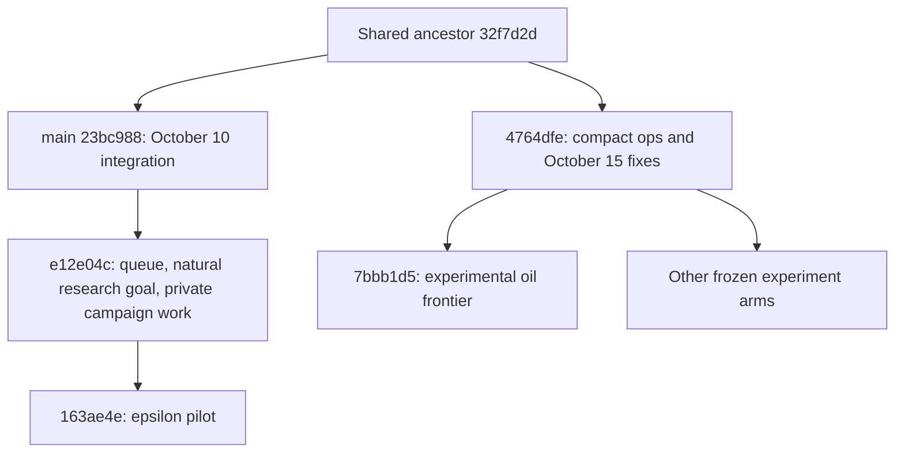

<!-- Path: docs/rl/Laya_Weekly_Reset_Audit_2026-10-17.md | Purpose: Inspect the week's Laya changes, divergent branches, experiments, learning evidence and reset options without changing runtime state. -->

# Laya weekly inspection and reset proposal

**Window:** October 10, 2026 00:00 IST through the October 17 audit, with evidence captured approximately 07:32–07:44 IST. Dates use committer time for inclusion; the commit inventory retains author time separately. Older history is used for lineage and context, not counted as new work this week.

**The reset should begin with consolidation and a common acceptance contract, not another new scheduler.** Significant parts of the proposed architecture already exist on an older development branch. The recent batches use another lineage that lacks them. The richer branch also failed to finish the factory. Neither “merge everything” nor “rewrite everything” follows from the evidence.

The week produced useful mechanics, observability and execution work. It did **not** establish a winning end-to-end policy or a new ops-trained checkpoint. Branch continuity, work semantics and experiment targeting now limit how much that work compounds.

This report expands and qualifies [the initial audit](Laya_Structural_Audit_2026-10-17.md). In particular, research completion, useful-progress signatures, typed geometry refusals, queue execution and some observation fixes are absent from the recent compact branch, **not absent from the repository's history**. Reimplementing them without this inspection would repeat work.

## Inspection coverage

| Evidence inspected | Coverage and qualification |
|---|---|
| Reachable Git history | 340 commits in the window: **186 non-checkpoint commits**, **154 T3 root snapshots**. Product commits comprise 160 stable patch-ID groups; 26 groups have exact patch twins. Counts are not feature counts. |
| T3 snapshots | All 154 indexed; **47 distinct complete trees**, across 19 checkpoint thread prefixes. Root snapshots are not implementation commits. No unrelated conversation contents were read. |
| Branches and worktrees | All **17 local heads**, **47 registered worktrees**, archived refs and cleanup manifests; changed tracked files and known uncommitted drafts. Product commits touch **210 distinct paths**. |
| Main development lineages | `main@23bc988`, queue/campaign `e12e04c`, epsilon `163ae4e`, compact ops `4764dfe`, matrix controller `80b2882`, and all current experiment branches. |
| Requested T3 conversation | All **29 messages**, eight user / 21 assistant, in `8ca8aa59-53f0-47d1-8277-1c84bbf27f8a`, read through a read-only SQLite connection. Raw conversation is not copied into repository evidence. |
| Main working agent handoff | User-provided October 15–17 commit/run summary and standing requirements, cross-checked against refs, manifests, raw records and pause note. |
| Experiments and runs | 35 first-loop runs; three successor-loop runs; five later campaign collections; two supervised single runs; 37 persistent-controller segments; early October 15 validations/jumpstart; 24-job epsilon pilot; 216-job matrix; three completed fresh batches totaling 272 jobs; current partial day batch. Overlapping indexes and continuations are not added into a fictitious total. |
| Learning artifacts | Located checkpoint/dataset/policy-iteration/counterfactual roots and training-related changes. Most recent located trained checkpoint is October 3 R31, a separate workflow profile. |
| New verification | 46 focused checks passed on the current checkout. An immutable `e12e04c` export ran 171 selected checks: **170 passed, one failed**, reproduced alone. No gameplay execution or full-suite success is claimed. |

The exhaustive [commit ledger](laya_helper_runs/weekly-audit-20261017/commit-ledger.md), [branch ledger](laya_helper_runs/weekly-audit-20261017/branch-ledger.md) and [evidence index](laya_helper_runs/weekly-audit-20261017/README.md) retain identities and sources. This is a structural and historical inspection, not a claim to have manually reviewed every line of every patch or reproduced every historical result.

**Main-agent source addendum:** subsequently inspected thread `fded5a13-9121-40c5-9380-6e32819466a7`, “Fix Laya Construction and Mall Issues,” indexing 238 user/assistant records (47 user, 191 assistant). Its explicit instructions and relevant status reports confirm the supplied handoff. A [forwardable prioritized work list](Laya_Audit_Forward_Handoff_2026-10-17.md) incorporates this source. Raw conversation is not published in repository evidence.

New Luna delegation was unavailable because T3 `delegate_task` / `task_status` are not exposed. [AGENTS.md](../../AGENTS.md) requires direct reading in that case and prohibits substituting native collaboration. Existing Luna and coordinator reports were used as evidence and checked against raw sources where material.

## Requirements that survive the reset

- Every new live evaluation starts fresh from the **committed** `saves/mod_playground.zip`, SHA-256 `347eba65065014f82261330d84d5ca2fa3e3427cad3ab18dcfdf496dd9c442b0`. The user-authorized jumpstart experiment was an exception. No live resume/checkpoint continuation is implied by this proposal.
- Batch run feedback. Retain combined Haiku/Luna findings with corrections marked and raw citations.
- Gear/cable caps use their own chest and the user-specified `min(10 stacks, 1,000 items)` limit. Ended demand must remove requests and release the slot. This differs from leaving a permanently idle gated producer with ingredient WIP.
- Preserve bot-funded construction, ownership, protected production, immutable active experiments and complete outcome accounting.
- The real product goal is completed mining-productivity-4. Factory production, provider delivery, consumption and research completion remain distinct.
- The October 12 queue branch records user-approved continuous production/construction execution with Laya managing goals/order. That is a documented authority change, not an accidental new safety rule. Reconcile this contract across branches before deciding what the director should own.

The modified save in the working checkout hashes to `97634360…6d5bb`, different from the committed batch save. It was also used by the October 13 solo deterministic observation. Do not silently substitute it for a fresh evaluation input.

## The branch split explains repeated discovery

`HEAD` and `main` diverge at `32f7d2d`. Relative to current `HEAD`, main has 53 branch-only commits, and the queue branch has 124. The complete queue-branch tip comparison spans **204 tracked paths, 25,257 additions and 2,699 removals**. That is too much to call a one-factor policy comparison.

Only 16 of the 186 window product commits are ancestors of the current compact checkout. Thirty-three window product commits have no remaining named local head containing them, but remain reachable through preserved history/archives. Neither ancestry nor patch equivalence proves adoption or live success.

The October 10 cleanup archived complete worktrees and preserved refs/checksums; it did not destroy this work. Its final handoff named `main@23bc988` as the integration baseline, while the primary checkout remained on the older fleet lineage. Later development continued along both tracks. The main construction thread explicitly acknowledged the split and pushed both histories; it was not an unnoticed deletion or reset. The audited records do not establish that the queue architecture was rejected by a matched comparison. Nor does its age establish that it should replace the compact branch.

Local origin-tracking refs match the current main/compact/experiment heads and queue branch, consistent with the main agent's push summary. This audit did not contact the remote, fetch, push, switch branches or merge.

### Repeated mechanisms with existing implementations

| Mechanism | Earlier implementation | Later compact-line finding/change | Audit implication |
|---|---|---|---|
| Already-powered anchor leaves machines unpowered | `0709237`, October 12: check stranded consumers regardless of anchor return | `7bbb1d5`, October 17: skip already-generated anchor and enter stranded hookup | Same failure family reappeared on another lineage. Earlier version checks consumers more generally; compare both tests/semantics before integrating one narrow repair. Do not import the experimental latch with the correctness fix accidentally. |
| Pending coal mine treated as terminal defect | `378154e` / `8e16178`, October 10: typed construction wait plus diagnostic causes | `21bf861`, October 17: typed coal construction wait | An earlier reusable solution exists. The new arm had zero treatment exposure in 24 trials. |
| Goal output missing from observation/menu | `042fb55` / `9466086`, October 10, then research-frontier `5de56f6` | `a832bef`, October 16, followed by oil-parts `78d8557` | Observation capability must be shared. Repeated whitelist additions are not independent policy improvements. |
| Useful loan/bill progress and blocking time | `5130b80`, `77e43de`, `a6a731c`, `537b37f`, natural goal module | October 17 pipe batch incorrectly stalled while crafting | Do not build a second progress abstraction before testing the earlier one against this exact failure. |
| Research completion and labs | `a3ae7d5` / `c385d21`, `9bf5949`, then `5de56f6` | Missing from compact ops operation map and phase-completion contract | Code exists; delivered science/research success remains unverified. Port or repair the contract instead of declaring the whole feature unimplemented. |
| Structured retirement and persistent obligation | October 9/10 structured receipts and lifecycle work on main/queue line | `0393fe3` repairs compact-line string result; `1d54dd5` keeps retirement after phase | Contract tests need to travel with shared mechanics. Preserve each fix's exact scope. |
| Stocked C1 assembler | `7abc86d` / `87e9094`: explicit **c1-v2** | Compact batches and matrix use **c1-v1** | This is a changed predicate, not a like-for-like success-rate improvement. Preserve both labels. |
| Tests writing fake status milestones | `42d9bdb`, then cleanup `23bc988` | Synthetic `FIX-0001 / fix.py` entries remain in dirty compact status | A tested isolation repair already exists. Do not treat these entries as campaign achievements. |
| Physical fluid mirroring and Factorio 2.1 diagnostics | `73b0af6`, October 12 | Not present in current compact/oil frontier | A further known oil-service risk remains after the power repair. Old fix has geometry/unit/private deployment evidence, not demonstrated C4 completion. |

## What changed during the week, and what it bought

| Period / change family | Representative commits | Demonstrated impact | Limit / disposition |
|---|---|---|---|
| October 10 lifecycle and deterministic geometry | `ca314ff`, `24ae0de`, `2e5a2f0`, `378154e`, `8f338ea`, `3beebe1`, `5a8d6d3` | Long-arm bootstrap, retirement visibility, explicit blocked districts, collector alternatives and demand-aware siting implemented with focused coverage | Reusable mechanics candidates; no isolated full-factory effect demonstrated for each. |
| October 10 evidence/goal accounting | `5130b80`, `77e43de`, `042fb55`, `a6a731c`, `a3ae7d5`, `537b37f`, `a0ed8fc` | Separates blocking execution, claim-aware shortages, output observation and verified research goal from proxies | Existing substrate for reset; current compact arm does not contain it. Broader runs still failed. |
| October 10 runtime separation and campaign machinery | `c963e61`, `d9a1daf`, `c61abd5`, `a76551a`, `2cfeb79`, `43b94a5` | Namespaced runtime mods, frozen episodes, permission/entrypoint/report fixes | Operational value; first campaign had no functioning improvement cycle. No factory-success credit. |
| October 10–11 reviewed repairs | `652ba57`, `8fef101`, `c91becf`, `120e982` | Lab/plate legality, live lab catalog, loan-owned stock gates, retry facts | Four reviewed fixes; five exploratory runs, zero target completion. FIX4's audit found suppression could reset after idempotent research; final run had manual intervention. |
| October 11 storage, mall and persistent runtime | `6c3a223`, `219e3bb`, `5b41f87`, `0a50565`, `3b99d09`, `ba81540`, `8c28216`, `cac973a`, `8d67275` | Safer bot teardown, input API compatibility, preserved servers, helper lifecycle, financed precursor loans | Keep safety/API fixes with tests; persistent segments are not fresh-start trials. Enabled server lifetime later caused ownership/port surprises. |
| October 12 pre-queue fixes | `f2aa507`, `9867d14`, `2cd3796`, `37bb087`, `b9c5243`, `3b5e011` | Foundation continuation, construction claims, better power search, precursor/peer facts | Several personally observed repairs; no matched factory-performance result. |
| October 12 queue architecture | `a90a80f` and continuations through `c1fbde2` | Durable jobs, dependency edges, finite bills/delivery credits, resumption, fair polling, capacity continuation, repeating cross mall | Substantial implementation, followed by many corrective patches. One preserved world reached 13 physical mall assemblers and 30 completed jobs; still stalled at shared iron-route/copper-expansion geometry. Keep as challenger/reference, not automatically the reset baseline. |
| October 12 queue funding/WIP refinements | `db012a7`, `90ac900`, `67d7723`, `711d74e`, `37783c9`, `69f0710`, `dd98cf9`, `3dda5c1` | Individually funded work, remaining precursor quantities, owned batch inputs and removal of obsolete dependencies | These directly address the current transaction proposal. Review/consolidate them before adding another ledger. They did not establish end-to-end improvement. |
| October 12 research and oil service | `5de56f6`, `0709237`, `73b0af6` | Research-derived frontier, real lab builder, consumer power checks, physical mirroring/API and coal retry service | Useful missing capabilities. Private oil setup reached real machines; fresh plastic/research completion not proven. |
| October 13–14 campaign containment | `10ff9ac`, `d976c43`, `ba4a2ad`, `aa3ad55`, `e12e04c` | Fix non-pole power lookup, premature mined-input dispatch, escaped preparation waits, obstruction diagnostics, run-index size and retry horizon | Correctness/observability gains; repair loops still ended on stall/reporting/provider failure. |
| October 15 compact mechanics | `3f79d9e`, `25cbb68`, `439704d`, `0393fe3`, `3dcf9ac`, `2ab263b`, `8845426`, `c1482ae` | Budget preservation, stocked status, footprint reservation, retirement crash fix, restored gates, pole routes and shared substations | Strong narrow repairs. Manufacturing/evaluation failures persisted. Matrix does not establish a geometry winner. |
| October 15 compact demand controls | `4e433f6`, `5bfc84b`, `851bc92`, `9473ee3`, `1d54dd5` | Correct absolute target semantics, own-chest caps, loan release, feedstock growth and authorized restart experiment | `4e433f6` introduced a moving-target regression, repaired by `1d54dd5`; jumpstart did not resolve the stall. Generic fulfillment/release contract remains incomplete. |
| October 15–17 evaluation tooling and arms | `163ae4e`, `80b2882`, `4764dfe`, `a832bef` through `414bed2` | Epsilon eligibility, load gates, complete planned jobs, fixed-concurrency trials and oil-frontier experiments | Better evidence, no adopted policy winner and no located weight update. Preserve negative results and unexercised treatments. |

The commit ledger lists **every one of the 186 commits**, paths and added/removed functions, including documentation, harness and archived twins omitted from this condensed table. A generic `FIX-000N` subject is not used as evidence of its effect.

## Experiments: results and interpretation

| Collection | Exact scope | Result | What follows |
|---|---|---|---|
| First October 10 loop | 35/35 same-seed runs, 2,866 decisions | All stalled; recorded real C3 in 9/35, no C4–C6. All 35 Muse report publications failed; zero fixer commits | Gameplay and improvement-pipeline progress were confused. Recovered drafts do not retroactively make the loop successful. |
| October 10 successor loop | Three allocated/indexed runs | Two hard failures, one runner error; two verified fixes | Improvement handoff worked, but factory improvement was not established. A cached controller “OBSERVING” state is not present liveness. |
| First DeepSeek/Haiku campaign | Five runs, one revision each; same seed | Four fixes; real C2 in two runs, no research completion | n=1 per revision and final user intervention prevent causal performance claims. |
| Owning-GPT campaign | One run | `stalled_wall_30m`; real C1. Six-hour promise ended early on harness failure; proposed fix abandoned | Separate from gameplay failure; no subsequent verified adoption. |
| October 13 campaign | Four allocated episodes | Preparation hard failure, 96-decision stall, 2,300-decision stall, then 36m40s runner error. Two fixes | One long run logged 8,703 prerequisite deferrals; these are executor events, not 8,703 policy decisions. |
| October 14 ten-hour successor | Two episodes | 461-decision stall; then 1,817-decision / 15,378-second stall with real C2 | Second summary missing from index, recovered from terminal log. Campaign stopped early on reporting; `e12e04c` subsequently repaired record retention. |
| October 14 eight-hour successor | One episode | 1,391 decisions, approximately 3h05m; real C2, no research completion | Ended early on model/provider recovery failure. No successor gameplay fix was verified. |
| Persistent-controller work | 37 segments, 2,780 decisions | 27 deliberate stops, five stalls, three hard failures, two runner errors; no completed target | Important live mechanics evidence, heavily censored and often on the same world. Not 37 independent evaluations. |
| October 15 epsilon pilot | 24/24, six epsilon values × four seeds, `163ae4e`, c1-v2 | Verified C2 by epsilon 0/5/10/15/20/25%: **2/0/1/1/2/2 of four**; no terminal-failure winner | Tiny, noisy pilot on richer lineage, lacking newer compact fixes. Epsilon zero still samples proportional rule weights. No default change justified. |
| October 15 matrix core | 192 jobs, four cumulative code revisions × six epsilons × eight seeds; c1-v1 | **6 C1, 11 C2, one C3, zero C4**; 157 stalls, 30 runner stops at wall caps, five game-window stops | No overall architecture or geometry winner. Adjacent revisions isolate a code increment; first-to-last compares several changes. |
| Matrix calibration / confirmation | 12 / 12 separately | Calibration no C2; confirmation one C2 and one C3; no C4 | Do not combine selected development configurations with confirmation as independent validation. |
| October 16 morning | 96/96, four arms × 24 | Strict C2: control **9**, goal-producer **12**, reservation-release **13**, shortage-weight-8 **14**; all C4 zero | Proxy C2 was 12/15/17/15. Mixing these metrics overstates effects. |
| October 16 night | 80/80, four arms × 20 | Strict C2: **12/17/12/15**; C4 zero | Reservation-release's earlier apparent lead did not replicate. Oil-parts did not exercise pipe-to-ground scarcity in this cohort; do not infer mechanism success from C2 counts. |
| October 17 early | 96/96, four arms × 24 | Strict C2: **18/17/16/15**, strict C3 **5/3/5/4**, C4 zero | No challenger beat control. Coal treatment fired 0/24; handoff treatment in only 6/24. Three oil transactions opened. |
| October 17 day | Ongoing 64-job cohort; captured 07:42:40 IST | **19 completed, eight recorded running, 37 queued**; no terminal C4 in captured snapshot | Partial result only. Main agent's 07:38 snapshot had 16 completions. Wait for full cohort and terminal reviews; no adoption inferred. |

The three completed October 16–17 batches remain **272/272**, 265 stalls, seven window timeouts, 423 `untyped_stuck` outcomes, zero C4. Every terminal summary was checked in the initial audit. Across the distinct pilot, matrix and completed fresh batches, 512 jobs are represented, but they must not be pooled as one i.i.d. cohort or one revision's success probability.

### Matrix qualifications that matter

- All 216 admitted jobs have terminal statuses: 180 completed and 36 wall timeouts. Core/calibration/confirmation sizes are 192/12/12; optional unadmitted reserve blocks are not successful jobs.
- “Zero runner/harness errors” is compatible with **455 recorded action-error events**: 398 core, four calibration, 53 confirmation. These are event counts, not independent crashes. Preserve both metrics.
- Core C2 by code arm: restored gates **3/48**, tie-break **3/48**, pole rerouting **4/48**, shared substations **1/48**. Core action-error event counts were 64/131/181/22 respectively. Lower error-event count alone is not improved factory completion.
- Core C2 by epsilon 0/.05/.10/.15/.20/.25 was **1/1/0/5/3/1 of 32**. This is exploratory, crossed with four code revisions, with very few completions; it does not establish an optimal epsilon.
- The user's approved 20:50–21:50 IST controller pause, world-clock taper and priority reduction are documented in `PAUSED-BY-USER.txt`. The main agent reports 12 affected trials. Paused wall durations/caps are confounded; analyze affected pairs separately. Do not rewrite recorded durations as if uninterrupted.
- The pilot uses **c1-v2** and the matrix/recent compact batches **c1-v1**. Only c1-v2 counts a stocked inactive assembler as working. These counts are not interchangeable.

### Individual October 15–16 validations

`stock-fix` stalled at C0; `fullmall` reached C1 proxy; `cellreserve` had an unindexed string-receipt crash; `sharedsub` stalled at the absolute-vs-delta drill target. These are useful diagnoses, not matched effect sizes.

The first `chestcap` launch was aborted because prepare installed deployed mods rather than the frozen Lua. The corrected launch staged `--mods-source`, reached C3 proxy and exposed uncapped inserter output, limited gear capacity and stale loan ownership. This is why code hash alone is insufficient runtime provenance.

The first jumpstart world ran 1,173 decisions before being stopped. The moving target from `4e433f6` kept asking for one more splitter; the main agent records roughly 172 restores and 158 splitters. `1d54dd5` fixed the target at failure time and restored phase-independent retirement. On its next world, the initial segment and both authorized restarts still stalled; restarts are not three independent fresh successes. Keep the experiment as negative evidence against controller reset as a general recovery strategy.

The October 16 observed run reached C2/C3 proxy at approximately +1,039 seconds, then had wait-only C4 choices. That justified the goal-producer/catalog investigation, not a claim of complete factory capability.

## Actual learning and the deterministic comparator

No window product commit touches the inspected fine-tuning, dataset, counterfactual, input-profile or sequence pipeline. No new ops-compatible trained checkpoint was located in the inspected artifact roots. The latest located checkpoint is October 3 **R31**, profile `workflow-health-v1` / `factorio-decision-v2`, with 7,313 historical optimizer updates; its 432-case held-out evaluation is lab evidence, not factory C0–C6 acceptance. Its promotion metadata explicitly denies real-Nauvis eligibility.

Both the compact and queue factory CLIs use guided or uniform sampling. The week collected decisions and executed tests; it did not demonstrate optimizer updates flowing into a served factory policy. `choice_points=58,966` in the matrix core means menus with choices were recorded, not that 58,966 informative counterfactual labels or training updates occurred. Queue promotions and automatic executor work require separate attribution.

Untracked mall-population/growth and GPU-benchmark files in the current checkout are mostly dated September 20–October 3 and belong to separate supplied-input/lab work. Their presence is not evidence of this week's ops training. They are preserved, not scheduled for deletion.

The actual deterministic controller also failed in the October 13 solo observation: medium poles/steel formed a budget cycle; no research started. That run used dirty revision `32f7d2d`, save `97634360…6d5bb`, speed 1, unlike the committed-save speed-2 Laya batches. It cannot establish comparative Laya advantage or infer the effect of later fixes. A real matched incumbent comparator remains needed.

## Structural conclusions after reviewing the whole week

1. **Continuity is a first-order defect.** Correctness fixes and contracts are duplicated across branches without a shared regression corpus or a recorded integration decision. The next large gain may come from retaining existing work rather than inventing another abstraction.
2. **The queue is a serious candidate, not a proven cure.** It already represents dependencies, finite demand and owned credits, but repeatedly required readiness/WIP/continuation fixes and stalled at unchanged geometry or bootstrap prerequisites. Its explicit scheduler owns mechanical continuation under a user-approved contract. Evaluate that design honestly instead of describing it as either a completed director or automatically illegitimate hidden strategy.
3. **The economic interface is still the central technical constraint.** Absolute stock levels, remaining quantities, source reachability, requester WIP, reservation ownership, producer existence and delivered output repeatedly diverge. Per-item fixes treat the symptom; a single versioned fulfillment contract is still needed.
4. **A spatial dead end needs a new legal alternative.** Both lineages repeatedly exhaust an owned collector or belt approach. Better queue order cannot make an absent site/route candidate exist. Preserve ownership and immutable submitted geometry while exposing bounded alternatives.
5. **Observation and acceptance are not shared enough.** Incident-specific catalog patches, different C1 predicates, historical force counters and missed pre-retirement achievement windows complicate interpretation. Completion must be measured at the event and versioned.
6. **More trials and more reviewers are not sufficient.** A treatment that never fires, a broken report pipeline, quota recovery, capped trials after a user pause, and inaccessible operations all constrain useful evidence. None are fixed by simply admitting more servers or increasing model effort.
7. **The closed learning loop remains disconnected.** The project should decide whether the next tranche is tool reliability, empirical policy optimization, or learned scoring. Calling all three “training” obscures the absence of a served policy update.

## Reset disposition

| Keep / recover | Re-test or redesign | Retire from active use after an explicit decision |
|---|---|---|
| Bot construction, validators, ownership and immutable plan mechanics | One fulfillment/receipt schema spanning compact and queued ops | Duplicate scheduler/ledger implementations that cannot explain their distinct role |
| Narrow reproducible safety/API fixes; exact parent-failing tests | Queue readiness, WIP ownership, batch completion and slot release | Stale synthetic status entries as performance evidence |
| Committed-save/mod hashes, complete cohort manifests, negative results | Consumer-power semantics using both October 12 and October 17 regressions; physical fluid settings | Repeated full-run weight/batch-size sweeps with no measured treatment exposure |
| Existing natural-goal/research/lab and progress interfaces as implementation sources | Shared live recipe/capability closure and versioned milestone evidence | Controller restart as the default response to structural deadlock |
| Old trained checkpoints and supplied-input experiments, clearly scoped | Spatial alternative generation and actual incumbent comparison | Automated edit/run loops that count observation failures as completed improvement cycles |

“Retire” means quarantine/archive and stop selecting it by default, **not delete history, saved worlds, models or evidence**. No row in this table has been executed by this audit.

### Recommended sequence

**First: produce an integration decision, not a merge of the two tips.** Name a reset candidate in a new isolated branch when implementation is requested. Keep `4764dfe`, `e12e04c` and `7bbb1d5` immutable as references. Record which user contract is current, especially queue authority, fresh starts, caps and slot release. Do not use the old dirty save.

**Second: assemble the smallest common correctness/evidence substrate.** Reuse the existing research-goal contract, useful-loan progress, structured receipts, catalog facts, and safe construction/physical fluid corrections after checking their dependencies. Integrate independent fixes separately and run their actual regressions; do not silently import an entire unadopted experiment arm. The concrete consumer-power fix is a correctness candidate, not evidence for adopting the latch.

**Third: use one fulfillment representation.** A finite demand names its consumer, exact remaining bill, accessible source/network, claimed stock, WIP, delivered credits, progress and release condition. Reuse the queue/reservation implementation where suitable. Remove the need for a chemical rung to be “ever stocked” as a substitute for fulfilling an owned bill. Laya must be able to choose an exposed prerequisite or alternative even when the displayed proxy phase is earlier.

**Fourth: make one fresh-start oil-to-plastic slice work.** Existing offline captured-state regressions can test the 125-handoff loop, advancing pipe loan, static collector refusal, power/port mismatch and stale slot ownership. These are tests, not live checkpoint starts. Every live validation remains fresh under the user's rule. Require newly produced **and delivered** plastic, then unchanged C5 sustained service, before expanding to more scheduling/model experiments.

**Fifth: compare policy/execution modes on common mechanics.** The two branch tips differ too much for a causal architecture claim. Once their shared correctness/observation contracts agree, compare compact direct requests versus admitted-work queue as one declared treatment. Keep predicates, save, mods, seed pairs, caps and catalog fixed. Change spatial search or learned scoring in later separate experiments.

**Sixth: connect actual learning deliberately.** Produce reviewed, representation-compatible decision/outcome cases, group related replays into one split, train one challenger, record changed checkpoint hash, actually load it in the factory runner, then evaluate held out. Track useful choice coverage and delivered progress; do not train by imitating queue promotions or label unavailable alternatives as failures.

The first reset result should show **fewer unchanged retries, correct batch progress and fulfillment, and substantially more strict C4/C5 completions**. The initial audit's 12/24 C4 and 10/24 C5 figures are proposed engineering targets, not evidence or promotion rules. Apply the existing long-window, safety and earlier-service non-regression gate. Full replacement still requires advanced-circuit consumption, completed mining-productivity-4 and held-out incumbent comparison.

No new architecture experiment should automatically change the current running day cohort. Complete its existing protocol and merge the observers' findings as the main agent planned. A further live snapshot/resumption experiment requires explicit user instruction; this reset proposes none by default.

## Verification, outstanding uncertainty and lifecycle

The immutable `e12e04c` check selected natural-goal, acceptance, work-queue, ops-runner, research-lab and physical-fluid tests. **170/171 passed.** The one failure reproduces alone: an acceptance fake lacks `replacement_actions`, now required by `economics()`. It is evidence of test-contract drift; it does not establish a malformed live district. The main agent separately reports 3,792 passes / ten inherited failures / 34 skips on its compact mechanics round. That historical full-suite comparison was not rerun by this audit.

The first audit's current-checkout 46 passes remain valid for that scope. No all-green fast gate, new live recovery, model improvement, arm adoption or production success is claimed. Historical reports with known exemptions retain those exemptions in the evidence index.

User-systemd liveness could not be queried in this sandbox. The main agent reports that the enabled persistent server restarted at login; this is operational context, not independently probed current state. Existing services, ports, CPU priorities, saves, mod copies and campaigns were not operated on. Only audit artifacts/status/handoff were written; no product implementation, commit, merge or push was made.

**Lifecycle action now: none.** An authorized implementation would require isolated verification and new frozen Python runners; any Lua/namespace/schema-dependent deployment requires deliberate matching mod staging and server reload, queued behind active campaigns. This inspection grants no real-base authority and performs no operational reset.
