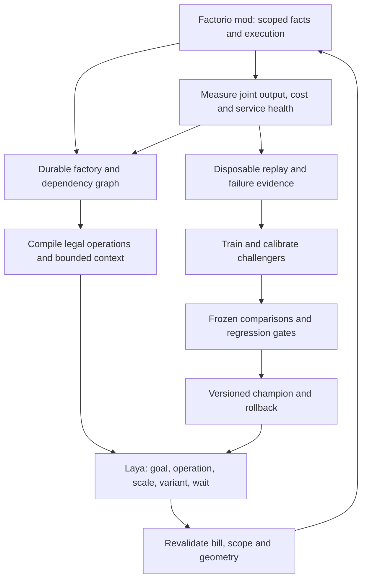

<!-- Path: docs/rl/Laya_Workflow_Audit_2026-09-30.md | Purpose: Evidence-backed audit of Laya workflow learning, bottleneck control, evaluation, and the path to an expanding Factorio factory. -->

# Laya workflow audit — 2026-09-30

## Verdict

The project has demonstrated that measured outcomes can teach useful build
ordering and tier decisions. The current workflow is a promising small
decision laboratory. It has not established replacement of the deterministic
runner, reliable bottleneck diagnosis, or autonomous factory expansion.

The highest return now is improving the **meaning of the training evidence,
the facts available to the policy, and the actions it can execute**. More
rounds of the unchanged workflow can reinforce undesirable waiting and cheaper
failed factories. A larger model would still face these problems.

Keep Laya as the local director, retain the deterministic workflow as the
comparison incumbent, and develop a factory control loop that can observe,
repair, expand, and measure existing infrastructure. Introduce more products
after the early curriculum can distinguish those decisions reliably.

This is an audit and proposed implementation sequence, not a change to
production authority or the existing promotion contract.

## Scope and evidence

Reviewed the September 30 handoff; architecture, invariants, training and
deterministic documentation; connected-workflow scenario/candidate generation;
Lua setup, execution and measurement; the Laya runner, toolkit, work graph and
supply projection; counterfactual labelling and ETL; the features baseline;
sequence rendering, model runtime and fine-tuning; overnight orchestration;
offline and batch evaluators; failure records and matched comparison gates.

Repository HEAD was `880efd8`. The overnight log identifies its frozen code
as `1de07ac`. Findings distinguish repository inspection from reanalysis of
stored Factorio execution evidence. Deployed workers were not probed, changed,
restarted, or redeployed. Existing unrelated worktree changes were preserved.

Evidence reanalysed:

- `data/laya-pi/overnight/summary.log`;
- `data/laya-exploration/batches/ov-eval-rollout-L{1,2}.jsonl`;
- `data/laya-exploration/batches/ov-eval-laya-r26-min19-L{1,2}.jsonl`;
- `data/laya-exploration/batches/ov-eval-laya-r28-L{1,2}.jsonl` and their journals;
- `data/laya-counterfactual/labels/ov-r27-p{0,1,2}.jsonl`, including alternative
  journals for every label whose minimum cost was at least 36,000;
- `data/laya-pi/overnight/dataset-r28.jsonl` and checkpoint configurations.

Narrow verification: 22 existing tests passed across counterfactual labels,
feature baseline, matched comparisons and sequence construction. These tests
verify their present contracts; they do not disprove the behavioral and
evaluation limitations below. No new Factorio episode or GPU experiment was run.

## 1. What the current loop actually learns

```text
sample translated cell layout and randomized demand
  -> execute rollout or features-policy trajectory
  -> replay its prefixes, force each alternative, continue with that policy
  -> convert final costs to soft choice labels
  -> refit features policy on accumulated cases
  -> fine-tune Laya on selected recent case files
  -> evaluate on repeatedly reused seeds 4001–4032
```

This is approximate policy iteration with counterfactual outcome labels and
model distillation. It makes sense for a small action space. The continuation
policy gives each action a value under the current policy, rather than an
optimal value. Improvements therefore depend on trajectory coverage,
continuation competence, action expressiveness, and valid measurements.

The active labeller accepts `rollout` or `features` continuation, not Laya
continuation. Most new decision states are consequently visited by the
features policy. Laya's own failure states are not automatically relabelled in
the overnight loop. The fine-tuner's RLCD component rewards agreement with the
prepared soft targets, alongside supervised loss; it does not run Factorio
inside each gradient update. Calling this direct on-policy Factorio RL would
overstate the implemented workflow.

Useful foundations to retain:

- explicit disposable runtime isolation and pre-execution validation;
- paused-clock stepping for reproducible comparisons;
- measured alternatives rather than blindly copying old cascade choices;
- shared training/inference sequence construction and overflow rejection;
- separate seed-derived dataset splits, soft labels and calibrated adapters;
- journals, failure packets, checkpoint recovery and the Operations Console;
- separate matched-workflow comparison code with conservative authority gates.

## 2. The reported results need a reliability interpretation

Costs below use the existing objective: completion ticks, plus 10 per estimated
material unit, plus 60 per decision. Non-completions use 36,000 ticks before
the other charges. Means include all 32 episodes.

| Policy | L1 completed | L1 median / mean | L2 completed | L2 median / mean |
|---|---:|---:|---:|---:|
| Scripted lab rollout | 32/32 | 6,854 / 6,859.8 | 28/32 | 8,093 / 12,442.0 |
| Laya r26-min19 | 32/32 | 6,167 / 6,272.3 | 28/32 | 7,495.5 / 11,869.5 |
| Laya r28 | 28/32 | 6,148 / 10,595.7 | 27/32 | 6,491.5 / 12,804.9 |

R26 is the stronger current reference. Its mean cost improves by approximately
8.6% on L1 and 4.6% on L2 versus the scripted lab rollout. R28's better medians
coexist with worse mean costs and lower completion. On L1, its four failed
seeds built only the independent construction branch and then alternated
waits until the no-progress limit. They did not fail from choosing a cheap
production tier. One L2 failure is a separate lab constraint issue described
below. "Under-building" does not explain every regression.

The four L2 non-completions for both r26 and the scripted rollout are seeds
4012, 4014, 4030 and 4031. On seed 4012, the rollout builds both furnaces with
fast inserters and AM2 assemblers, but finishes with measured belt output of
0.60/s against a 0.664/s target. R26 also builds both furnaces there. On seed
4030, r26 builds only one furnace and basic tiers. There are both possible
capacity/measurement limitations and policy mistakes; their remedies differ.

**Required feasibility probe:** force the legal high-capacity variants, allow
sufficient measurement time, and test each failing demand with long output
windows and simultaneous objectives. Establish whether the available menu can
satisfy it. The existing rollout failure is evidence to investigate, not proof
that the seed is impossible. Do not teach a preferred tier from an unverified
assumption about feasibility.

The present baseline is `ScriptedPredictor` in
[`tools/laya_counterfactual_labels.py`](../../tools/laya_counterfactual_labels.py),
a small hand-written lab rollout. It is not an execution of
`tools/autonomous_run.py`. None of these results establishes a head-to-head
win against the full deterministic opening.

## 3. Urgent learning and measurement defects

### A. Failed continuations teach full-weight waiting

Round 27 contains **269 of 618 labels (43.5%) for which every measured
alternative fails to complete**. The alternative journals confirm all 269
have only `failed` terminal statuses; their base journals report maximum
episode ticks elapsed. Every one chooses a wait as a cheapest alternative.
Every usable case among these labels receives case weight 1.0.

Example: seed 6495, decision 1: waiting costs 38,460, construction 39,000,
and iron 39,460. All outcomes fail. The target rewards waiting because it
avoids material spending under a continuation that does not solve the task.

Cause: `outcome_cost()` collapses every non-completion to the horizon and then
adds spending/decision costs; `label_to_case()` trusts the resulting preference
and uses the overall cost spread versus replay noise for confidence. A large
spread between bad outcomes is treated as strong evidence of a good choice.
The label itself does not preserve per-alternative status and failure cause.

Fix the evidence contract before changing the optimizer:

1. Store each alternative's completion, termination cause, progress, delivered
   deficits, measured costs, replay identity and continuation hash explicitly.
2. Prefer valid completion over non-completion regardless of incidental cost
   savings; enforce safety as a separate gate.
3. Quarantine environment/tool/measurement failures from policy preference.
4. For all-failed alternatives, mark solution preference unresolved. Relabel
   under a stronger continuation or use validated progress/recovery evidence.
   Cost savings alone must not become a confident positive wait target.
5. Measure confidence using the gap between the best and second-best valid
   alternatives and repeat uncertainty, not just best-to-worst spread.

Do not discard all failed trajectories: they are valuable failure and recovery
evidence. Stop labelling their cheapest failure as the solution.

### B. Level 3 measures separate historical successes

In `advance_multi_requirement_sample()` in
[`episode_measurement.lua`](../../factorio_training_lab/episode_measurement.lua),
each requirement latches `closed` once its own sustain period passes.
Previously closed requirements need not remain above target while another
product catches up. This is explicit current behavior.

That is appropriate for some one-time milestones. It does not establish a
factory sustaining competing belt and circuit demand together. Use a common
current acceptance window for continuing throughput objectives; reopen an
objective when current evidence falls below its target. Keep milestones and
ongoing service obligations as distinct contracts. Add a post-completion
soak with shared resources and no new subsidized inputs.

### C. Expansion is partly a geometry limitation

Level 3 reuses the L2 `iron2` cell, which sends plate to gears rather than
the plate supply used by both product chains. The scenario comments and
handoff record that adding it did not increase L3 belt capacity in the tested
layout. The narrower demand range works around the limitation.

Build a physically effective L3 expansion and measure its marginal effect
before adding L3 to automatic rotation. Choose demands on both sides of
verified capacity boundaries. Cover cases where expansion helps and where a
different bottleneck makes it wasteful.

`iron2` closure also uses total furnace count, with different magic thresholds
for L2 and L3. Replace this with branch-owned entity/transaction evidence and
delivered contribution. Total furnace count cannot identify the health or
existence of a particular production service as the menu grows.

### D. A transient ground item is counted as forbidden infrastructure

R28 L2 seed 4009 builds iron2 before gears. Its terminal observation contains
`item-on-ground: 1`, one forbidden entity and one budget overrun, with no
out-of-bounds entities. `audit_entities()` includes non-resource,
non-fixture entities in construction counts. A dropped item thus acquires a
zero construction budget and triggers a safety failure.

Separate world items from built infrastructure in the audit. Record spillage,
lost output and destination readiness as facts/costs; retain actual entity,
scope and budget protections. This is a generic measurement fix, not a rule
that Laya must always build gears before a furnace. Validate receiving
infrastructure where execution actually requires it.

## 4. Observations cannot yet support bottleneck understanding

The lab adapter deliberately reports stock, draw rate and capacity as unknown.
The runner also leaves remaining materials, remaining construction budget and
remaining tick budget unknown. Most power, robots, accessible inventory,
machine utilization, transport and spatial facts are absent. The bottleneck
hint is usually a terminal failure kind, not a current production diagnosis.

Production counters show what was crafted on a surface; they do not establish
where it went, which consumer is starved, or whether extra machines would
help. Laya cannot distinguish missing input, insufficient machine capacity,
blocked output, power shortage, and an inaccessible construction bill from
the available rates alone.

Extend the existing supply-evidence seam with measured facts:

| Facts | Decisions they enable |
|---|---|
| Accessible stock, reservations, bills, expected delivery and construction state | Wait for funded construction, make missing items, or choose a smaller build |
| Input/output inventories, per-service throughput, working/starved/blocked fractions | Repair supply/transport or add productive capacity |
| Recipe/prototype rates, machine counts and measured draw | Calculate demand and expected capacity changes |
| Power production/load/satisfaction and available fuel | Expand power or defer load |
| Robot/service coverage, charging and pending ghost blockers | Expand logistics or finish existing construction |
| Resource depletion, connections, space and corridor occupancy | Mine elsewhere, route, reserve space or expand |
| Explicit remaining time/actions/materials; evidence age and measurement coverage | Choose feasible scale and observation/wait timing |

Use live Factorio prototypes and recipe arithmetic for quantity/rate facts.
Computing ingredient demand and physical capacity does not decide which
project to prioritize. Avoid asking a small text classifier to discover exact
ratios from approximate material-price numbers.

Keep a durable factory graph outside the model context. Query a bounded
relevant neighborhood for each decision, including dependencies and contested
supplies. Expand aggregate fields beyond the features baseline's single
secondary target. Unknown facts must retain availability indicators; the
features baseline currently turns missing rates into zero.

Absolute server tick and seed-bearing surface/force identifiers appear in the
model sequence. They are irrelevant to most choices and can become shortcuts
or distribution shifts. Keep runtime identities in validation/journals and
train a new renderer using relative episode/transaction ages and semantic
service identifiers. Test invariance to renamed scopes, episode start ticks,
translated/rotated geometry and option permutations before removing any
field from an established checkpoint's representation.

## 5. The action space cannot yet repair a bad factory

`serve_goal_options()` removes a whole branch once any of its plan hashes
has executed. A reopened work-graph branch therefore does not provide a new
build, upgrade or repair for that service. The work graph can reopen on fresh
measurements, but the executor cannot generally act on that reopening.

Connected-workflow candidates offer fixed cells and tier substitutions.
Recovery mostly waits, retries an execution, reselects a stale candidate or
escalates. Choosing a cheap inserter is effectively irreversible within an
episode. Factory health remaining below demand does not trigger an executable
diagnostic/repair menu.

Introduce bounded edit operations on existing services:

- observe a relevant machine, route, inventory or construction project;
- upgrade inserters/machines without duplicating the whole service;
- add a parameterized increment of machines and connect it to live supplies;
- repair an input/output connection, power reach or blocked construction;
- reroute or resize transport; throttle/allocate contested production;
- retire an obsolete structure, recover permitted materials, or reserve space;
- wait until a measured wake condition or bounded observation horizon.

Each operation needs identity, estimated bill, expected effect, legality,
transaction receipts and rollback scope. The compiler enumerates legal
alternatives; Laya chooses. Do not hard-code that repair always wins or that
a specific item shortage always selects a furnace.

Move from verified cells to parameterized modules, then compositional edits
and topology choices. Allow Laya to learn which site, scale, route and layout
works through outcomes. An endlessly growing catalog of complete hand-built
factories would recreate the deterministic system's maintenance problem.

## 6. Improve training before increasing its volume

### Cover the states Laya actually reaches

Mix collection policies: the current features teacher, frozen strong Laya,
challengers, and seeded exploration. Relabel high-regret or failing Laya
states with the same renderer and legal options. Otherwise good offline
accuracy can coexist with live wait loops in states absent from training.

Use targeted multistep alternatives where one action cannot reveal benefit:
adding supply followed by connecting/allocating it, or upgrading an inserter
then observing steady flow. Enumerate small chains exhaustively as an oracle
for early curriculum families; use bounded beam/search continuations as the
menu grows. Record the continuation dependency of each target.

### Use cost gaps carefully

Once statuses and feasibility are correct, weight important regrets and
completion-critical decisions. Cap weights and balance by seed/trajectory,
level and decision kind so a long wait-heavy failure does not dominate.
Calibrate soft-target temperature to repeat uncertainty and near ties.

The features trainer currently ignores case/question weights. Its branch
features also cannot distinguish two serve options when their represented
numeric features and variant count match: branch identity, semantic effect,
dependency unlocks and affected item are absent. Strengthen this baseline
with option effects and demand/capacity relationships before using it as a
teacher for larger parallel workflows.

### Make recency and retention explicit

`LAYA_MIN_CASE_ROUND` is a fixed lower bound, not an automatic sliding window.
With minimum 19, the r28 dataset includes ten rounds; it will keep growing
until the operator moves that bound. Select a moving recent window plus a
balanced reservoir of validated earlier-level and recovery examples.
Invalidate or relabel examples when environment, measurement, renderer or
operation semantics change. Old evidence may remain useful, but mixing
contradictory targets without continuation/version information is hazardous.

The r28 dataset contains 5,054 cases from 360 seeds: 3,726 train, 511
calibration, 536 held-out and 281 test; 3,968 serve-goal questions versus 1,086
variant questions. Audit coverage by high demand, failure type and critical
variant choice, not simply total cases.

### Establish which learning objective earns its cost

Run a controlled ablation: weighted soft cross-entropy alone versus the
current soft cross-entropy plus RLCD objective, using identical data, budget
and seeds. Compare Factorio completion, regret and tail cost, not only loss.
Do the same for scratch-from-base versus adapter warm start with replay;
exact optimizer resume is a separate recovery mechanism.

The long-context 2,048-token profile enforces checkpointing and micro-batch 1.
Earlier 1,024-token kernel speed results are not proof of an equivalent gain
at 2,048. Compact useful facts and benchmark the current profile on an idle
GPU before adopting a faster configuration. Keep the good seed splitting,
lossless rendering and calibration controls.

## 7. Laya's limits and the architecture around them

Upstream describes Laya as a non-autoregressive typed decision engine. It
classifies supplied choices in a forward pass; it does not itself maintain a
factory, generate arbitrary executable plans, search long action sequences,
or update weights while playing. This project's fine-tuning is essential.
[Upstream Laya documentation](https://github.com/NandhaKishorM/laya).

Use that strength at bounded decision boundaries. The surrounding system
must provide memory, factual arithmetic, legal choices, execution, outcome
measurement and training. If Laya alone cannot rank long-horizon alternatives
well enough, test a learned value/effect model with limited disposable search,
or a structured graph/numeric policy against it. Keep strategy learned and
measured. Model branding is not a promotion criterion.



A practical deliverable is a Factorio mod plus a local model sidecar. The
current neural model executes in Python/PyTorch, while Lua owns game facts
and actions. A pure Lua mod containing the current neural runtime is not
implemented. Define the sidecar's restart, stale-observation, outstanding
transaction and model-unavailability behavior as part of the product.

## 8. Curriculum toward a self-expanding factory

The current environment supplies infinite ore, effectively supplied power,
fully unlocked primary research and direct entity creation subject to quotas.
These are useful early fixtures. They omit the item economy, ghost/bot
construction delays and coverage constraints of the real deterministic base.
L1 primarily varies a small set of translations; L2 adds demand. Unseen
numeric seeds are not yet broad unseen factory conditions.

Advance by demonstrated capabilities, with earlier families retained:

| Stage | Capability | Required evidence |
|---|---|---|
| Correct L1–L3 | Feasible demand, meaningful shared expansion, joint sustained outputs | Independent repeats; no invalid wait targets; capacity sweeps |
| Existing-factory recovery | Separate starved, blocked, unpowered, undersized and unfinished services | Random damage and demand shifts; useful repair/upgrade actions |
| Finite construction economy | Produce bills, reserve stock, build a mall, finish bot construction | No item grants; realistic coverage and delays; material ledger reconciliation |
| Power, extraction and logistics | Expand supporting services and handle depletion/terrain | Finite resources, varied sites, routes and coverage bottlenecks |
| Compositional production | Scale solids/fluids, balance contested intermediates, research | Joint product service levels; legal fluid networks; held-out layouts |
| Full workflow and endurance | Science progression and repeated expansion after demand changes | Matched real-opening benchmark; long soak and restart recovery |

Start introducing damaged/prebuilt factories, scarcity and demand changes
early. A curriculum consisting only of fresh construction cannot teach
maintenance. Randomize causes independently so "low output" is not always
the same problem. Verify scenario solvability and include explicit infeasible
tasks for calibrated defer/escalate behavior.

A self-expanding factory also needs a defined objective: research queue,
production service levels and growth/resource limits. "Expand forever" does
not specify when another machine is useful. Let the policy choose supporting
projects and scale from the objective and measured factory state.

## 9. Evaluation, operations and throughput

### Separate development selection from final promotion

Seeds 4001–4032 are repeatedly evaluated and used to select rounds/checkpoints.
They should now be treated as a development benchmark. Freeze a separate
untouched promotion suite across seeds, initial factory states, demand bands,
damage, terrain and budgets. Never use its outcomes to choose the next
training intervention and then call it untouched.

The batch comparator intersects seed sets, overwrites duplicate seeds while
loading, and checks neither a complete frozen suite nor matched starting
conditions. Missing/duplicate/mismatched results must block promotion. Its
`faster_than_baseline` field counts lower composite cost, even when both runs
fail; rename the interpretation and report completion wins separately.

Use the stricter existing `compare_matched_runs()` seam for replacement
evidence. It requires independent primary execution, explicit conditions and
all expected cases. Current exploration batches explicitly lack that authority
and are not replacement evidence. Its per-case material/time non-regression
gate is deliberately conservative; any later statistically justified
tradeoff gate must be defined explicitly before a trial, not relaxed to admit
an attractive checkpoint.

Select by zero safety violations, reliable completion and earlier-family
non-regression first, then paired efficiency and tails. Report mean,
completion-conditioned cost, p95 or worst-tail cost, worst demand bands,
regret, errors, wall time and repeated-run variation. Use paired confidence
intervals and adequately sized cohorts. Offline accuracy is diagnostic;
confidently scoring a bad continuation label is not factory competence.

### Match the real opening before replacing the runner

Run both policies on independent disposable copies of the same starting
state, inventory, research, objective, budgets, Factorio/mod versions and
construction rules. Include routes, power, robots, supply and damaged or
partially built states. Do not give Laya direct-placement/infinite-supply
privileges during the promotion comparison.

Preserve the incumbent snapshot and rollback. Promotion remains an explicit
separate production decision, followed by bounded trials with health
monitoring. Add long-duration demand shifts and restart tests: succeeding at
an opening is weaker than maintaining an expanding factory.

### Improve useful labels per hour

Profile time spent in replayed prefixes, tick bursts, RCON/report polling,
plan compilation/validation, disk I/O and inference before asserting that more
processes will double throughput. The handoff's throughput suggestion is a
hypothesis, not a verified speed result.

Prioritize all-failed continuations, disagreements, high regret, unexplored
demand boundaries and recovery states. Avoid repeatedly enumerating nearly
identical late waits. Use matched snapshot/prefix caching only after proving
inventory, entity, RNG and measurement-state fidelity. Full state comparison
must cover decision-relevant facts: the present faithfulness check compares
option lists and work-branch projections rather than the complete pre-action
state.

For Laya rollout/evaluation, a bounded inference queue can batch compatible
decisions while retaining exact marker/option mappings. `LockedPredictor`
currently serializes inference. Upstream now documents batching, but this
repository uses a custom non-truncating representation and PEFT runtime:
adopt batching through that representation and benchmark local decisions.
Upstream's performance figures do not establish a gain on this laptop or
speed up features-only counterfactual labelling.
[Upstream batch API](https://github.com/NandhaKishorM/laya#batch-mode-score-many-states-in-one-forward-pass).

### Make unattended lifecycle claims exact

The driver's deadline gates starting another round. A labelling round can
have a four-hour timeout; a fine-tune may have a 240-minute timeout; final
evaluation follows. An eight-hour launch is therefore not a hard guaranteed
stop at eight hours. Add remaining-budget-aware phase limits and an
ownership-scoped cleanup trap. Preserve partial evidence and resumability.

Named runs namespace artifacts but do not themselves establish exclusive
worker ownership. Use worker leases and model/GPU phase ownership. Validate
actual deployed mod/scenario hashes at handshake; a frozen Python checkout
alone does not pin Lua, saves or installed dependencies. Require complete
seed accounting before accepting a round assembled from partial labellers.

## 10. Implementation order and acceptance gates

| Priority | Smallest coherent milestone | Acceptance | Lifecycle after implementation |
|---|---|---|---|
| 1 | Per-alternative outcome/cause contract; unresolved all-failed labels; complete comparison cohorts | Round-27 bad wait targets excluded/relabelled; explicit error versus policy credit; missing cases rejected | Restart Python labeller/training consumers |
| 2 | Joint L3 sustain; transient-item audit; branch-owned expansion evidence and effective shared supply | Controlled capacity sweeps; simultaneous output soak; spillage does not count as construction | Deploy lab Lua and restart affected stopped workers/GUI plus consumers |
| 3 | Stock/draw/capacity/health observations and upgrade/repair operations | Demand-shift or damaged factory recovers through a measured useful edit | Deploy changed lab Lua and restart consumers |
| 4 | Relabel Laya states; strengthen teacher; balanced moving replay; CE/RLCD ablation | Completion and tails improve on fresh development cohorts, with earlier levels retained | Train new artifacts; restart disposable runner for selected artifact |
| 5 | Finite economy and construction service, then broader production | Repeated expansions funded by actual stock, with sustained joint output | Deploy scenario/runtime mechanics and restart disposable workers |
| 6 | Matched deterministic-opening benchmark and endurance suite | Frozen independent primary runs establish reliable advantage; rollback preserved | Separate explicitly authorized promotion lifecycle |

Do not prioritize fleet-wide throughput expansion before priorities 1–2: it
would collect more evidence with the same semantic defects. Retain r26 as a
reproducible reference; it still needs new independent evaluation and earns
no real-base authority from this audit.

## What self-improvement must mean operationally

The current overnight driver automatically collects labels, trains and
evaluates, but assigns the latest features model as the next continuation
without a completion/regression acceptance gate. Failure packets and
improvement-proposal schemas exist; automatic causal diagnosis, curriculum
selection and gated adoption are not integrated into this driver.

Complete the loop as explicit durable steps:

1. Cluster recurring failures with their observation, operation and outcome
   evidence; identify whether the fault belongs to policy, telemetry,
   measurement, mechanics or unavailable actions.
2. Reproduce it in disposable worlds and establish a useful alternative.
3. Relabel or add a randomized curriculum family; train a challenger with
   pinned provenance and bounded compute.
4. Compare against the current champion, features baseline and deterministic
   reference where applicable, including prior-level and recovery coverage.
5. Accept only through the declared gate; preserve the incumbent on regression.
6. Record the failure reduction, new failure classes, cost and rollback
   artifact, then allocate the next collection budget from those results.

This lets Laya improve decisions and recover from bottlenecks without turning
each failure into another hand-authored strategy branch. Source/schema/tool
changes still require the repository's verification and authority boundaries.

**Lifecycle for this audit: none.** This document and its status entry change
no policy, worker, save, installed mod, service or active training configuration.
